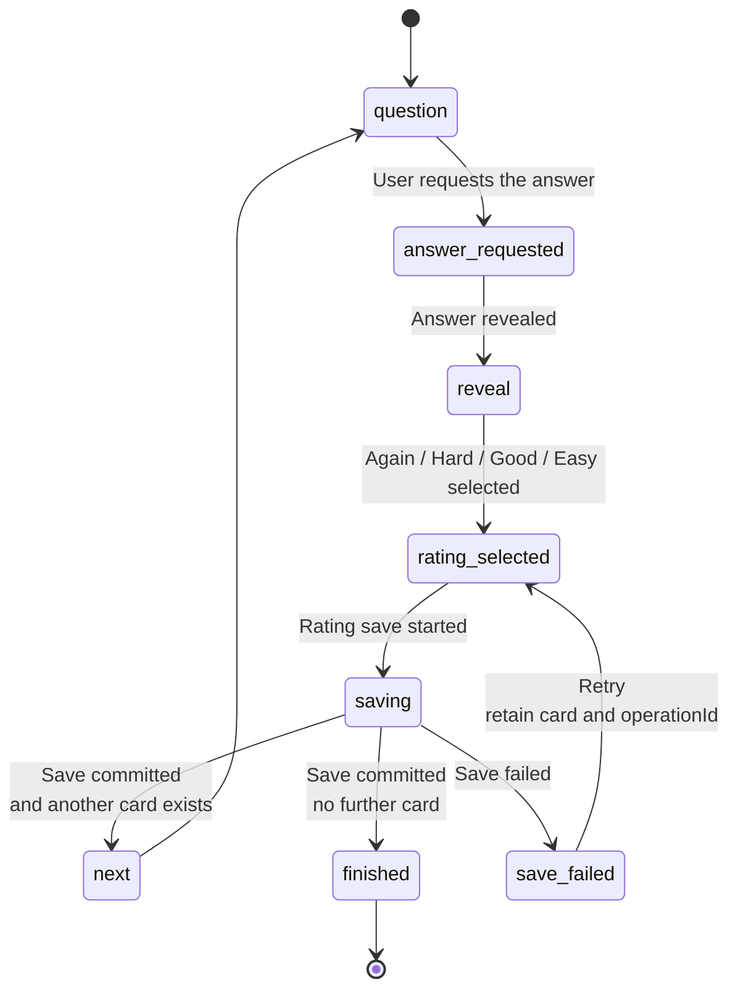

# Detailed Implementation Plan — Rust + Tauri 2.x + Svelte 5 + TypeScript

**Version:** 5.0 — consolidated implementation plan  
**Date:** 2026-10-09  
**Status:** Plan for implementation. The Rust codebase status requires an audit; no new phase is automatically complete.  
**Approach:** GUI-first → stable contracts → Rust and persistence → integrate features into existing screens → hardening → beta → release → post-launch development.

## 1. Purpose and consolidation rules

This document consolidates the previous Rust/Tauri/GUI-first roadmap, the Svelte 5 + TypeScript frontend update, and the v4.2 implementation addendum. It is a self-contained implementation plan and supersedes versions 4.0, 4.1, and 4.2.

Consolidation rules:

1. The application core is implemented in Rust; the Svelte 5 + TypeScript frontend handles presentation and interaction.
2. First, all primary screens, dialogs, and user flows are built against deterministic demonstration data.
3. After the complete GUI is accepted, production logic is connected incrementally to the existing screens; no second GUI is built.
4. The previously completed Phases 1–3 refer to Kotlin Multiplatform, not Rust. An audit, data/test migration, and revalidation are required.
5. The plan retains FSRS-6, offline learning, DE/EN content, associations, grammar tips, word links, editor, browser, statistics, CSV, backup, notifications, beta/release, and post-launch development.
6. This document is one consolidated Markdown file; versions 4.0–4.2 do not need to be maintained in parallel.

Notation: `[DECIDE]` — product-owner decision; `[SPIKE]` — technical experiment ending with a result and ADR; `[OPTIONAL]` — scope that may be deferred. A checkbox represents an outcome to verify, not an already-completed item.

## 2. Product, user, and scope

The product is a flashcard application for a Polish-speaking learner of German or English, initially at CEFR levels A1–B1. The user knows the concept of Anki but expects simpler configuration and learning based on vivid mnemonic associations. [file:2]

Languages are three distinct settings:

- UI language: Polish and English.
- Native language (L1): Polish by default; a parameter for mnemonic prompts.
- Target language (L2): German or English; a property of the deck.

v1 release scope: Android and iOS. macOS serves as a development environment and auxiliary demonstration shell; it is not automatically a desktop release commitment. Windows/Linux and a standalone browser/PWA application with production persistence require a separate D-01 decision.

The frontend is a static SPA built with Vite: HTML/CSS/TypeScript in the `dist` directory, with no Node server required at runtime. Tauri supports Svelte frontends and recommends Vite for SPAs; its configuration identifies the development server and output directory. [web:37][web:38]

SvelteKit is not required. Any later introduction requires an ADR covering static builds and routing; SSR/server endpoints must not become an implicit dependency of the native application.

v1 non-goals: cloud synchronization, accounts, deck marketplace, cloze deletion, image occlusion, handwriting, filtered decks, and a local LLM. The schema is prepared for future synchronization, but no synchronization server is implemented. [file:2]

## 3. Target technology stack

Library versions are pinned after a compatibility spike and dependency audit. “Svelte 5” means a deliberately selected and pinned 5.x version, not an automatic upgrade to a future major version.

| Area | Choice | Rule |
|---|---|---|
| Core | Rust stable, Cargo workspace | One domain logic implementation |
| Shell | Tauri 2.x, compatible CLI/API/plugins | Android/iOS; macOS for development |
| Frontend | Svelte 5 + TypeScript strict + Vite | `.svelte` components with `<script lang="ts">`; SPA |
| UI reactivity | Runes `$state`, `$derived`, `$effect`, `$props`; context | No React hooks and no FSRS in JavaScript |
| Shared UI state | `.svelte.ts` modules, context, explicit types | Presentation-level form/session state |
| Data and cache | `AppApi` + query layer; optionally `@tanstack/svelte-query` after a spike | No React bindings |
| Routing | Typed SPA router, hash strategy | Shared navigation/back/deep-link contract |
| Styling | CSS variables, responsive layouts, semantic HTML | Themes and design-system components |
| Local database | SQLite + rusqlite, bundled SQLite with FTS5 | Accessed only through Rust |
| Migrations | Numbered SQL + checksum + fixtures | No unverified migrations |
| Serialization | serde + serde_json, streaming NDJSON | Versioned DTOs and content schema |
| Dates | chrono + chrono-tz, injected `Clock` | UTC in core; IANA and cutoff for study day |
| LLM network | reqwest + Tokio, timeout and cancellation | Requests and secrets remain outside the frontend |
| Errors | thiserror + `ErrorDto` | No panic as a user-facing error |
| DI | Explicit traits and `AppState` | No reflective container |
| Logging | tracing + redaction + rotation | No card content or secrets |
| Settings | SQLite; small store for local preferences | A secret is not a preference |
| Secrets | SecretStore: Android Keystore/iOS Keychain; macOS Keychain in development | Custom plugin after spike if needed |
| i18n | i18next core + reactive Svelte adapter, PL/EN | No react-i18next |
| Rust tests | cargo test, proptest, Criterion | Domain/data/transactions/performance |
| Frontend tests | Vitest, `@testing-library/svelte`, Playwright, axe-core | Component/browser E2E; WebView separately |
| Static checks | rustfmt/clippy/audit/deny; svelte-check/tsc/ESLint/eslint-plugin-svelte | TypeScript and `.svelte` files |
| Notifications | Tauri plugin adapter + native fallback after spike | Per-target compatibility |
| TTS | Adapter/plugin in Swift/Kotlin | No assumed parity with Web Speech |

Svelte 5 introduces runes `$state`, `$derived`, `$effect`, and `$props`; reactive logic can be shared in `.svelte.ts` modules. New components use runes mode, without mixing React examples or legacy Svelte patterns. [web:40][web:43][web:44]

Svelte recommends Vitest with Vite; Svelte Testing Library provides adapters and plugins for component tests, including Svelte 5. [web:39][web:45][web:46]

Stronghold is not automatically equivalent to Keychain/Keystore. Any vault requires a separate threat model, unlocking approach, and recovery policy; its password must not be stored in a plaintext application file. Tauri capabilities limit API exposure per window/WebView, but do not replace validation of custom commands and domain rules. [web:4][web:8]

## 4. GUI-first architecture and contracts

```mermaid
flowchart TD
    User["User"]

    subgraph Frontend["Frontend — Svelte 5 + TypeScript"]
        UI["`.svelte` components<br/>Dashboard / Study / Editor / Browser"]
        Controller["`.svelte.ts` controllers<br/>screen state and UX validation"]
        Context["Svelte Context<br/>AppApi / i18n / Router / Theme"]
        Mock["MockAppApi<br/>deterministic fixtures<br/>Phases 2–6"]
        TauriAdapter["TauriAppApi<br/>invoke / events"]
    end

    subgraph Tauri["Tauri 2.x"]
        Commands["Rust commands<br/>DTO and input validation"]
        Events["Rust events<br/>job_progress / collection_changed"]
        Jobs["Job runtime<br/>import / backup / LLM"]
    end

    subgraph RustCore["Application core — Rust"]
        UseCases["Application layer<br/>use cases / transactions"]
        Domain["Domain layer<br/>FSRS-6 / Scheduler / policies"]
        Ports["Ports / traits<br/>Clock / RNG / SecretStore<br/>LlmClient / Notifications / TTS"]
    end

    subgraph Infrastructure["Infrastructure"]
        SQLite[("SQLite<br/>decks / notes / cards<br/>review logs / FTS5")]
        LLM["LLM provider<br/>reqwest + Tokio"]
        Secrets["SecretStore<br/>Android Keystore / iOS Keychain"]
        Native["Platform adapters<br/>notifications / TTS / files"]
        Content["Bundled content<br/>NDJSON + manifest"]
    end

    User --> UI
    UI --> Controller
    Controller --> Context
    Context --> Mock
    Context --> TauriAdapter

    Mock -.->|"Phases 2–6:<br/>demonstration data"| UI
    TauriAdapter -->|"invoke"| Commands
    Commands --> UseCases
    UseCases --> Domain
    UseCases --> Ports
    Ports --> SQLite
    Ports --> LLM
    Ports --> Secrets
    Ports --> Native
    Ports --> Content

    Jobs --> Events
    Events --> TauriAdapter
    TauriAdapter -.->|"subscription / cleanup"| UI
```

The frontend handles presentation, routing, forms, and UX validation. Rust is the source of truth for rating, time, FSRS, queueing, domain validation, imports, and transactions. The GUI has no universal “execute SQL” command and contains no second FSRS implementation.

### 4.1. Contract rules

- Components use `AppApi` from context; they do not call `invoke()` directly.
- `MockAppApi` and `TauriAppApi` implement the same interface; the adapter is replaced during application initialization, not in screens.
- The contract includes `apiVersion`, typed DTOs, enums, optional fields, and an error catalogue.
- SQLite `i64` IDs are transported as strings to avoid precision loss in JavaScript. GUIDs are strings. Transport timestamps use UTC ISO-8601; SQLite uses epoch milliseconds.
- TypeScript types are generated from Rust DTOs after the spike; CI detects contract drift. An initial TS/JSON-Schema contract is acceptable, but Rust becomes the DTO source in Phase 7.
- Long-running operations return a `jobId`. Events include `jobId`, sequence, status, and progress; `get_job_status` allows status retrieval after returning to a screen. An event is not durable truth.
- Mutations use `operationId` and idempotency; entity version protects against saving a stale form.
- A rating returns the persisted state, next card, and counters. Optimistic persistence is not committed before the database transaction succeeds.
- `ErrorDto`: `{ code, messageKey, retryable, details }`; the UI translates `messageKey`, not raw SQL or stack traces.
- Release uses the production adapter. Demo has a banner and separate storage/profile; an IPC error never silently switches to the mock.

### 4.2. Svelte 5 patterns

- `.svelte` components: `<script lang="ts">`, props through `$props`, local state through `$state`, derived values through `$derived`.
- Shared UI controllers in `.svelte.ts`; typed context provides `AppApi`, i18n, and services.
- `$effect` is used only for controlled side effects: focus, listeners, timers, and theme. It is not a place to automatically mutate the database after every state change.
- Rating/save/import operations are invoked in explicit event handlers with `operationId` and a pending state; reactive effects must not repeat a mutation.
- Subscribe/listen/unlisten and request cancellation have lifecycle cleanup. Asynchronous listener registration accounts for unmount before registration completes.
- DOM events use `onclick`/`oninput`; component communication uses typed callback props. Composition uses snippets/render rather than designing a new library around legacy slots. [web:40]
- Stores remain acceptable when integrations require them; legacy `$:` syntax and runes are not mixed arbitrarily in new code.
- Mutable state is not a global singleton shared across independent demo/production profiles. The root creates separate service/controller instances.

### 4.3. Screen and session state

`UiState<T> = loading | empty | ready | error`. Connectivity, `stale`, in-flight mutations, and `pendingOffline` are separate attributes. Offline does not replace available local content.

The study session uses this state machine:



Rules:

- `saving` blocks a second rating of the same card.
- `save_failed` retains the card, selected rating, and `operationId`.
- Undo applies only to the last committed rating in the current session, with card-version and later-mutation checks.
- Interval previews include a card/preset version token; the backend rejects stale previews or explicitly refreshes them.
- Durable session state is stored in Rust/SQLite, not only in Svelte `$state`.

### 4.4. AppApi sketch

```ts
type Id = string;
type Rating = 'Again' | 'Hard' | 'Good' | 'Easy';

interface AppApi {
  getDashboard(): Promise<DashboardDto>;
  getDeck(deckId: Id): Promise<DeckOverviewDto>;
  startStudy(input: StartStudyInput): Promise<StudySessionDto>;
  getRatingPreview(input: PreviewInput): Promise<RatingPreviewDto>;
  rateCard(input: RateCardInput): Promise<ReviewResultDto>;
  undoReview(input: UndoInput): Promise<ReviewResultDto>;
  saveNote(input: SaveNoteInput): Promise<NoteDetailsDto>;
  searchCards(input: SearchInput): Promise<CardPageDto>;
  generateAssociation(input: GenerateInput): Promise<JobDto>;
  previewImport(input: ImportInput): Promise<ImportPreviewDto>;
  commitImport(input: CommitImportInput): Promise<JobDto>;
  createBackup(input: BackupInput): Promise<JobDto>;
}
```

This is a sketch, not a complete compilable module: DTOs and remaining methods are defined in Phase 2. `AppApi` does not depend on Svelte and can be tested as ordinary TypeScript.

### 4.5. Routing and i18n

The router provides typed `navigate`, `back`, `replace`, params, and an unsaved-changes guard. A hash strategy works without a path-resolving server. Native deep links are mapped to application routes through an adapter after validation; arbitrary externally received URLs are not executed.

The router library is selected after a spike covering Svelte 5 support, focus/scroll restoration, and mobile back behavior. A small custom hash adapter in TypeScript is acceptable if tests are maintained. React Router and SSR are not introduced.

i18next core is initialized before render. The Svelte adapter reacts to language changes, provides typed keys and pluralization, and components recalculate text and formatting. There is no react-i18next and no literal UI strings in `.svelte` files except explicitly documented technical exceptions.

## 5. Shared Definition of Done

Every phase:

- [ ] Has tests and acceptance criteria appropriate to its level; demo UI does not impersonate a durable application.
- [ ] Has green CI: Rust, frontend, svelte-check, contracts, lint/i18n, and dependency audit.
- [ ] Externalizes new strings in PL/EN, supports plurals, and tests loading/empty/error states.
- [ ] Supports keyboard/focus/labels/screen reader and 200% text scale; offline does not block local functionality.
- [ ] Ships a schema change with a migration, fixture test, and recovery plan.
- [ ] Keeps secrets, card content, and prompts out of unredacted logs/telemetry.
- [ ] Updates ADRs, documentation, and the UI→backend matrix.
- [ ] Records a demonstration and limitations; from Phase 1, performs smoke tests on the Android emulator and iOS simulator; physical Android devices are required from the Phase 6 gate onward (owner decision 2026-10-12); iOS stays on the simulator until a physical iPhone is available (owner decision 2026-10-29).

In Phases 2–6, functional tests may use mocks, but mobile smoke tests use the real shell/WebView. A browser test does not close the DoD for a native application.

## 6. Roadmap — phase list

| Phase | Outcome | Business backend |
|---|---|---|
| 0 | KMP audit and data/test migration plan | No |
| 1 | Rust/Tauri/Svelte 5/TypeScript toolchain, smoke tests, CI | Transport/spike |
| 2 | Design system, contracts, mock API, routing | No |
| 3 | Dashboard, study, summary — complete GUI | Mock |
| 4 | Details, editor, browser, deck — complete GUI | Mock |
| 5 | Statistics, settings, onboarding, transfer/backup GUI | Mock |
| 6 | Complete GUI and contract acceptance | Mock; gate |
| 7 | Rust domain/data, schema, migrations, IPC/secrets | Yes |
| 8 | Bundled content, importer, linter | Yes |
| 9 | FSRS-6 and scheduler, conformance | Yes |
| 10 | Real learning flow on existing screens | Yes |
| 11 | CRUD, browser, links, hierarchy/presets | Yes |
| 12 | Statistics/settings/backup/restore | Yes |
| 13 | LLM/cache/offline queue/moderation | Yes |
| 14 | CSV and Anki interoperability | Yes |
| 15 | Native TTS/deep links/notifications | Yes |
| 16 | Instrumentation, QA, security/performance | Yes |
| 17 | Beta/compliance/signing/release | Yes |
| 18 | FSRS optimizer and v1.1 | Yes |

After Phase 6, all screens exist as accepted GUI. After Phase 10, the first real offline learning product exists. These milestones are not equivalent.

---

## PHASE 0 — Source audit and migration strategy

**Goal:** separate the completed KMP work from work required in Rust; secure data, content, and tests.  
**Input:** plans, repository, and sample databases if available. Documents do not confirm the actual repository state.

### Steps

1. Create an archival KMP tag/branch; do not delete code before securing fixtures/content.
2. Inventory the FSRS engine, the declared 135 data-layer tests, v1/v2 migrations, importer/resolver, and 4 decks/113 cards; these figures describe the input state and must be verified.
3. Classify artifacts: migrate unchanged (content/vectors), port (logic), replace (Compose/Gradle/platform APIs), or remove after migration.
4. Determine whether production installations exist. Without them, the new Rust schema may start at v1. With them, backup and import/migration are mandatory; never reset data during an update.
5. Preserve fixtures for every real version of the old database and a manifest of fields/GUIDs/logs/configuration.
6. Resolve models: `note_id` for associations/tips, one source of truth for `config_id`, Unicode ranges, complete undo, and Anki/statistics constraints.
7. Open D-01–D-14, the content/licensing track, and privacy work; close D-09 for Svelte 5/TypeScript.
8. Mark old ✅ statuses as “reference implementation; port/revalidation required.” If a React prototype exists, retain UX/test references but migrate UI implementation to Svelte.

### Tests and DoD

- [x] The migration manifest covers tables/artifacts and readable copies.
- [x] The fresh-database versus existing-user-data migration decision is approved.
- [x] Content, licenses, vectors, and migration history are preserved.
- [x] New phases contain no unjustified completed statuses; the target frontend is unambiguous.

> **Status 2026-10-12.** [docs/migration/kmp-audit.md](migration/kmp-audit.md) classifies artifacts by category (FSRS, models, use cases, SQL, importers, content, APKG, tests) and keeps the KMP repository as a read-only reference; no inherited ✅ remains and D-09 (Svelte 5 + TypeScript) is closed. D-12 resolved: fresh database ([ADR-08](adr/ADR-08-fresh-database.md)); the project is a clean slate that reuses KMP code and assets as reference. Instead of an archival tag in the KMP repository (owner decision: no changes there), the source commit `c2fa62f` is recorded and all reused assets are copied with SHA-256 checksums ([scripts/fixtures.lock.json](../scripts/fixtures.lock.json), verified in CI by `scripts/verify-fixtures.mjs`). [docs/migration/kmp-manifest.md](migration/kmp-manifest.md) maps every KMP table/column to the Rust schema and inventories the 137 KMP tests. Copied: 4 decks/113 records (`content/decks`), schema + v1→v2 migration and the APKG (`tests/fixtures/kmp`), FSRS defaults and test specification (`tests/fixtures/fsrs/kmp-fsrs-spec.json`). Caveats carried forward: license metadata is preserved but rights are not yet confirmed ([content/PROVENANCE.md](../content/PROVENANCE.md), release-blocking for D-04); KMP had property tests, not numeric FSRS vectors, so Phase 9 must generate them from a pinned reference; content lacks note GUIDs, word-link ranges and pre-generated associations.

## PHASE 1 — Rust + Tauri 2.x + Svelte 5 + TypeScript toolchain

**Goal:** a working shell on target platforms without learning-domain logic.  
**Dependency:** Phase 0.

### Step 1 — repository and build

1. Create the Cargo workspace, `src-tauri`, Svelte 5 + TypeScript + Vite frontend, fixtures/content/docs directories.
2. Pin Rust, Tauri CLI/API/plugins, Svelte 5.x, TypeScript, Vite, and a compatible `@sveltejs/vite-plugin-svelte`; commit lockfiles.
3. Use TypeScript strict; add `check`, `lint`, `test`, and `build` scripts. `check` uses svelte-check and correct TypeScript configuration; `.svelte` files are not covered by plain `tsc` alone.
4. Configure Android SDK/NDK/JDK and Xcode/iOS SDK. Android API 26+ and iOS 16+ are plan requirements to validate through builds, not an automatic stack guarantee. [file:2]
5. Run browser development, Tauri on macOS, and Android/iOS builds. Configure the Vite dev server/output directory in Tauri; on mobile, ensure the device can access the development server.
6. Separate demo/dev/beta/release storage, profiles, and identifiers. Browser demo does not require a Rust server.

### Step 2 — native proof of capability

7. Implement `get_app_info` and a test event; validate DTOs/errors. This is infrastructure, not business logic.
8. `[SPIKE]` SecretStore: save/read/delete a test secret on the Android emulator and iOS simulator (physical Android device at the Phase 6 gate, owner decisions 2026-10-12 and 2026-10-29; physical iPhone when available); create a custom plugin if the wrapper does not meet requirements.
9. `[SPIKE]` Notification permission/send/schedule/tap, TTS, file selection/save/share — separate result per target.
10. `[SPIKE]` WebView: Svelte component, keyboard resize, safe areas, focus, CSS, orientation, and 200% text scale.
11. Configure CSP and minimal capabilities; no remote page is a privileged GUI.
12. If a React prototype exists: remove React/ReactDOM/React Router/react-i18next from dependencies, `.tsx` from the target build, plugin-react from Vite, and React-specific lint/test setup. Migrate components, not merely `package.json`.

### Step 3 — automation

13. Frontend CI: svelte-check, TypeScript, ESLint + Svelte plugin, tests, build, and i18n lint; Rust CI: fmt/clippy/test/audit.
14. PR build smoke; release-like mobile builds at milestones, iOS on a macOS runner. Signing secrets remain outside the repository.
15. Add tracing/redaction/app version/controlled crash test; telemetry is disabled by default.
16. Add a README with setup, browser-demo/mobile commands, and limitations.

### Tests and DoD

- [x] The Svelte shell starts in the Android emulator, the iOS simulator and the browser demo. *(Changed 2026-10-12 by owner decision: emulator/simulator instead of physical devices in Phase 1; physical-device review moves to the Phase 6 gate.)* *(Closed 2026-10-13: Android emulator 2026-10-12, iOS simulator 2026-10-13, see [device-smoke.md](release/device-smoke.md). The 3 s start target is still missed on the Android emulator, ~4.5–5.0 s; re-measured on physical devices at the Phase 6 gate.)*
- [x] Command/event/error/permission tests pass.
- [x] Native spike result: works / requires plugin / deferred, with an ADR. *(Closed 2026-10-15: ADR-12 Accepted. Confirmed on both iOS simulator and Android emulator via `#/diagnostics`. Notifications and Files work with official plugins; SecretStore works via keyring-core; TTS and Share work via stock Web APIs on iOS but require native plugins on Android.)*
- [x] svelte-check and build pass; React is not a UI dependency.
- [x] Versions are pinned, CI is green, and no unsupported “all platforms work” claim remains.

> **Status 2026-10-15 (update).** **Phase 1 complete — all DoD items checked.** Done: Cargo workspace; Tauri shell as library + `mobile_entry_point`; Svelte 5/TS strict/Vite with `check`/`lint`/`lint:i18n`/`test`/`build`; exact pins (Rust `tauri =2.12.2`, `tauri-build =2.7.1`, npm `@tauri-apps/api`/`cli` 2.12.2), lockfiles; toolchain 1.90.0 with rustfmt/clippy; CSP; capabilities with an app command manifest (`core:event:default` + `allow-get-app-info` only). Tests: IPC through the mock runtime (allowed command, ACL denial, unknown command, `app-ready` event, capability content) plus contract/error tests in Rust and TS. Step 15: rotating file logs with field redaction, content-free crash report and controlled crash test, `appVersion` in `AppInfoDto`; telemetry absent (off). Android: JDK 17, SDK, NDK r27 LTS and targets installed; `gen/android` generated; debug APK (aarch64) verified on the Android emulator (Pixel 9 Pro, API 36 / Android 16); smoke checklist and native probes run. iOS: `gen/apple` generated, deployment target iOS 16.0; verified on iOS simulator (iPhone 17, iOS 26.5); smoke checklist and native probes run. SecretStore spike ([ADR-07](adr/ADR-07-secret-store.md), Accepted): `keyring-core` with native stores in `crates/infrastructure/src/secrets.rs`, probed via `#/diagnostics` (round-trip, persistence across restarts and no plaintext in app files verified on both iOS and Android). Native capabilities spike ([ADR-12](adr/ADR-12-native-capabilities.md), Accepted): Notifications (`tauri-plugin-notification` =2.5.1) verified with permission prompt and delivery on both platforms; Files (`tauri-plugin-dialog` =2.8.1 + `tauri-plugin-fs` =2.6.0 via Rust) verified opening and streaming files via SAF `content://` and iOS security-scoped URLs and writing/reading backup files; TTS verified with 68 voices offline on iOS WKWebView, confirmed requiring native plugin on Android; Share sheet verified on iOS WKWebView, confirmed requiring native plugin on Android. Native variants dev/beta/release (`com.mila.langualinker.dev`/`.beta`/base) with separate app data, logs and WebView storage; [README](../README.md#app-variants). Phase 1 fully signed off; ready for Phase 2.

## PHASE 2 — Design system, routing, and mock API contracts

**Goal:** a shared foundation for every screen; contracts now, production logic later.  
**Dependency:** Phase 1.

### Step 1 — Svelte components

1. Light/dark tokens: surface/text/primary/success/warning/error/card states; CSS variables.
2. Typography, 4/8/12/16/24/32 spacing, shape/motion, and `prefers-reduced-motion`.
3. Responsive mobile/tablet/development desktop; bottom navigation/sidebar based on width.
4. Implement `DeckCard`, `StatTile`, `RatingButtonRow`, `WordLink`, `AssociationPanel`, `GrammarTipList`, `EmptyState`, `ErrorState`, `Skeleton`, `Chip`, `Dialog`, `Sheet`, `Toast`, `SearchInput`, `VirtualList`, and `ProgressPanel` as `.svelte` components.
5. Type props with `$props`; use callback props and snippets; use bindings only deliberately. Use SVG icons plus labels instead of emoji as the sole status indicator. Add a debug `/gallery`.
6. Create a reference screen/controller in `.svelte.ts`: `$state`, `$derived`, explicit event handlers, and lifecycle cleanup. Test that reactive effects do not repeat mutations.

### Step 2 — AppApi/scenarios

7. Define the operation catalogue: input/result/error/mutation/event/permission/screen/backend phase.
8. Define DTOs: Note/Card/Deck/capabilities/session/statistics/LLM errors/import preview/backup/permission state.
9. Implement `MockAppApi`: seed/time and scenarios for happy path, empty, loading, error, offline, quota, ambiguous, and large collection.
10. Mock editing/rating operates in demo memory; reset after scenario selection. No production persistence guarantee.
11. Typed Svelte context provides `AppApi`/i18n/router; the root provider selects demo/production, while components do not inspect their environment.
12. Add contract and payload tests; DTOs include real undo/resume data before the UI requires it.
13. `[SPIKE]` Cache/query layer: use a Svelte adapter only after verifying Svelte 5/API/version compatibility; custom query services are acceptable. No React bindings.

### Step 3 — routing/i18n/accessibility

14. Create nine routes: `/home`, `/deck/:id`, `/study/:deckId`, `/summary/:sessionId`, `/card/:id`, `/editor`, `/browser`, `/stats`, and `/settings`.
15. Add onboarding, editor parameters, settings transfer/backup/attributions, and not-found/error flows.
16. Implement hash routing: params, navigate/back/replace, draft guard, focus/scroll restoration, and native deep-link adapter. Record the choice in an ADR; no React Router/SSR.
17. Use i18next core + Svelte adapter, PL/EN, plurals/numbers/dates. Language changes react immediately in components.
18. Add fixtures for Polish characters, German compounds, emoji in content, and RTL; CI detects literal UI strings in `.svelte`.
19. Implement visible focus, semantic HTML, dialog trap/restore, contrast, and touch targets; the 48 CSS px target is a project goal verified on devices.
20. Add gallery snapshots, Vitest/Svelte Testing Library, and keyboard tests; define the browser/WebView matrix and diff acceptance rules.

### Tests and DoD

- [x] Every route opens a placeholder with the correct state/mock.
- [x] The gallery works in PL/EN, light/dark, and 200% without loss of function. *(Closed 2026-10-14: Playwright matrix in Chromium and WebKit, see the status below; native WebView evidence from the Phase 1 smoke runs.)*
- [x] Components do not import Tauri APIs; the adapter is replaceable through context.
- [x] Runes/lifecycle/query/router/i18n patterns are approved. *(ADR-01, ADR-02, ADR-05 and [docs/frontend/patterns.md](frontend/patterns.md) accepted 2026-10-12.)*
- [x] The demo banner and CI check prevent accidental mocks in release.

> **Status 2026-10-12.** Implemented in `frontend/src`: tokens (light/dark, 4–32 spacing, motion with `prefers-reduced-motion`), responsive shell (bottom nav / sidebar at 52rem), the 16 listed components plus `Icon`, `Disclosure`, `LinkedText`, debug `/gallery`; reference controller `features/study/studyController.svelte.ts`; contract v0.2 (`api/types.ts`, `appApi.ts`, operation catalogue `operations.ts`), `MockAppApi` with nine seeded scenarios; custom query service (ADR-02); hash router with params, guards, focus/scroll restoration and deep-link validation (ADR-01); i18next + runes adapter, PL/EN plurals and the literal-string CI check (ADR-05). Evidence: 99 Vitest tests (routes render on mock data, contract/transport rules, scenarios, router, query races, i18n parity/CLDR plurals, dialog focus trap, 50k VirtualList DOM bound, controller double-tap/retry/no-repeat), ESLint `no-restricted-imports` for `@tauri-apps/*`, `verify:release`. Open: visual verification of the gallery in PL/EN × light/dark × 200% (jsdom cannot prove layout — Playwright snapshots per [docs/testing/ui-test-matrix.md](testing/ui-test-matrix.md)), physical WebView check of 48 px targets, and approval of ADR-01/02/05 and [docs/frontend/patterns.md](frontend/patterns.md). Phase 1 device/spike items remain open in parallel.

> **Status 2026-10-14.** DoD closed. Playwright 1.64.0 + `@axe-core/playwright` 4.13.0 added (`npm run test:e2e`, CI job `e2e`): [e2e/gallery.spec.ts](../frontend/e2e/gallery.spec.ts) runs the gallery in PL/EN × light/dark × 100/200% × 360/1280 px in Chromium and WebKit, checking ui-test-matrix rule 4 (no clipped, overlapping or off-screen controls, no horizontal page scroll), the dialog/sheet/toast flow including Back, and axe (zero serious/critical); [e2e/routes-layout.spec.ts](../frontend/e2e/routes-layout.spec.ts) checks rule 4 on all 14 routes at 200%/360 px in PL and EN. 152 tests pass locally. Fixes found by the run or carried over from the smoke checklist: Back with an open dialog/sheet now closes it (router layers, ADR-12 finding 3); the demo banner's scenario select widened every page at 200% (378 px on a 360 px screen); dialog actions scrolled out of view at 200% (only the content scrolls now); the theme is applied before the first render (no light flash); bottom-nav labels get `hyphens: auto`. Open, not DoD-blocking: gallery pixel baselines must be generated on Linux CI (manual `E2E baselines` workflow) and committed; the `e2e` job has not run on the remote yet; nav hyphenation, the iOS `#/editor` 3 px overflow and Back on devices are re-checked at the Phase 6 gate; 48 px touch targets on physical devices remain a Phase 6 item.

## PHASE 3 — Learning GUI: Dashboard → Session → Summary

**Goal:** a complete demonstration flow without real FSRS or SQLite.  
**Dependency:** Phase 2.

### Step 1 — Dashboard

1. Deck list: language/type/due/new/overdue/progress/streak; empty and preparing-content states.
2. New deck/study everything/open deck/resume/refresh. Refresh does not require network for a local application.
3. “No cards” is distinct from “no reviews due today”; every CTA leads to an action, not a dead end.

### Step 2 — Study

4. Front → reveal → Again/Hard/Good/Easy with fixture intervals; `$state` reflects an explicit study controller, disabled during mock save.
5. Sections driven by `DeckCapabilities`: Simple/TextWithAssociations/Linguistic; associations/tips collapsed initially.
6. Word sheet: translation/tips/associations, phrase/unresolved/ambiguous; selection stored in the mock.
7. Undo/suspend/bury/flag/edit/delete — complete dialogs, messages, and mock actions.
8. Space reveals; 1–4 rates; keyboard capture is disabled in inputs; touch and screen-reader accessibility.
9. Association states: pending/offline queued/API error/invalid output/moderation/quota; generation does not block rating.
10. TTS button distinguishes unsupported/no voice; mock does not simulate native audio.
11. Pause/resume/recovery UX/leave guard; a browser reload test is not proof of native process death.
12. Subscribe/unsubscribe and cleanup in components; returning to a route does not duplicate mock events/requests.

### Step 3 — Summary

13. Ratings/time/distribution/effectiveness/next due from fixtures; not every proportion is true retention.
14. Again list and further study; no-Again and empty-session variants are separate.
15. Next deck/home/notification CTA after the first completed session; real permission comes later in the native adapter.

### Tests and DoD

- [x] Playwright: onboarding fixture → 20 ratings → summary → dashboard; undo/actions.
- [x] Three deck types render the correct sections.
- [x] Double tap/save error/no next card/back do not break state.
- [ ] TalkBack/VoiceOver/keyboard/200% pass on both devices. *(Keyboard and 200% pass in Chromium and WebKit. Android emulator with TalkBack, 2026-10-16: rows 11–16 pass (row 12 after fixing mid-word breaks in the rating row; nav labels at 200% remain a row-8 item); see [device-smoke.md](release/device-smoke.md). iOS simulator/VoiceOver run still open.)*
- [x] The result is described as a prototype, not production learning.

> **Status 2026-10-16.** Implemented on the mock (no FSRS, no SQLite), contract v0.3 ([docs/contracts/README.md](contracts/README.md#changes-in-v03-phase-3)). **Dashboard:** resume card with deck and progress, today tiles with the daily-goal meter, "Study everything", deck list; New deck dialog (validation, one `operationId` per intent); local Refresh; distinct states for no decks, decks without cards (add/import CTAs, per-deck "Add cards"), nothing due today (next review date, browse/stats/add CTAs) and content being prepared. **Study:** state machine extended with pause/continue (paused time is not answer time, also while the app is in the background), End session, `lost` recovery (missing session → start a new one), leave guard dialog; sections by `DeckCapabilities`, collapsed; word sheet (word/phrase, translation, tips and associations via `getNoteContent`, unresolved → add word, ambiguous → choice saved with `resolveWordLink`); undo, bury, suspend, flag, delete (confirmation) and edit; association generation as a background job with pending/offline-queued/provider-error/invalid-output/moderation/quota states that never blocks rating; TTS button with available/no-voice/unsupported via a `SpeechService` port (the mock does not simulate audio); Space/1–4 with input/dialog/modifier exclusions; focus moves to the answer after reveal and to the next question after a rating. **Summary:** time and per-card time, rating distribution, share without "Again" labelled as not being true retention, next due, Again list with "study these again" (`startStudy.cardIds`), separate no-Again and empty-session variants, continue/next-deck/home CTAs, daily-reminder offer after the first completed session (stores the time only; the OS permission is Phase 15). Every Phase 3 screen shows a prototype notice. New demo scenarios: `noCards`, `caughtUp`, `preparing`, `aiErrors`. Bug found by E2E and fixed: a rating tapped before the preview arrived sent an empty token and failed with `PREVIEW_STALE`; the commit now waits for the preview. Evidence: 163 Vitest tests (new: [tests/mockLearning.test.ts](../frontend/tests/mockLearning.test.ts), [tests/studyScreen.test.ts](../frontend/tests/studyScreen.test.ts), [tests/homeSummary.test.ts](../frontend/tests/homeSummary.test.ts), extended controller tests), [e2e/learning.spec.ts](../frontend/e2e/learning.spec.ts) in Chromium and WebKit (flow, keyboard, undo, card actions, leave guard, dashboard/study/summary at 200%/360 px in PL and EN with rule-4 layout and axe), full E2E suite 160 passed; svelte-check, ESLint, i18n lint, `verify:release` and Rust contract tests green. Open: device rows 11–16 on the Android emulator and iOS simulator; remount de-duplication is proven for job subscriptions and session loads, native process death is not (durable sessions arrive in Phase 10).

## PHASE 4 — Management GUI: details, editor, browser, deck

**Goal:** complete content-management screens before the backend.  
**Dependency:** Phase 3.

### Step 1 — Card detail

1. Front/back/favorite/history/tips/links; add/edit/delete/reorder.
2. S/D/R/due/reps/lapses/history panel; R is labeled with its calculation time.
3. Shared Note and two directional Cards: editing shared content while schedules remain independent.

### Step 2 — Editor

4. Front/back/tags/deck/NoteType Basic/Basic-and-reversed/Sentence; live template previews.
5. Association/tip/link fields driven by capabilities, inline generation, and manual association.
6. Duplicate warning, field validation, save/save-and-add-next, pending/conflict version.
7. Phrase selection and match picker; no match never selects a random card.
8. Unsaved-changes guard on back/route/close; draft is explicitly marked as demo.
9. Svelte form with typed controller and explicit submit handler; valid/dirty are derived state, not automatic saves in `$effect`.

### Step 3 — Browser

10. Virtual list/table, contract paging, search/help/parser error.
11. Deck/tag/state/flag filters, supported sort keys, and stable ordering.
12. Multi-select/scope/bulk change deck/tag/suspend/flag/delete/reposition; preview effects.
13. 50k paged-position fixture, not full DTO/DOM for all cards.
14. Select a virtualization library after a Svelte 5 spike; verify scrolling/selection/focus on mobile, without React wrappers.

### Step 4 — Deck overview

15. Counters/start/browser/add/edit; subdeck tree and collapse.
16. Rename/move/delete with card count and scope.
17. DeckType hides rather than deletes; mock confirms section restoration.
18. Preset picker/dependent deck count/clone and FSRS/limit editor.

### Tests and DoD

- [x] A reverse note shows two independent cards in the mock browser.
- [x] Draft guard/duplicate/conflict/bulk-confirm component tests pass.
- [x] Type change preserves data; VirtualList 50k does not load the full DOM.
- [ ] Keyboard selection and devices pass basic operations. *(Keyboard selection passes in jsdom and in Chromium/WebKit; the Android emulator and iOS simulator runs of the Phase 4 screens are still open.)*
- [x] Every button has a future backend contract; no dead actions.

> **Status 2026-10-20.** Implemented on the mock (no SQLite, no FSRS), contract v0.4 ([docs/contracts/README.md](contracts/README.md#changes-in-v04-phase-4)). **Card details:** the note (front/back, tags, type, sentence word links) and every card of it with its own S/D/R, due, reps, lapses and review history; R shows its calculation time; suspend/unsuspend, flag and delete per card (deleting the opened card shows the other one, deleting the last leaves for the browser); grammar tips add/edit/delete/reorder; associations favorite/add/edit own/delete/generate in the background; word links change/choose/unlink through the word picker; delete note (links pointing at the word become unresolved). Archived cards from a note-type change are named. **Editor** (`editorController.svelte.ts`, route `/editor?cardId=&deckId=`): deck (with subdeck depth), Basic/Basic-and-reversed/Sentence with live card previews driven by `EditorDataDto.noteTypes` and marked new/kept/restored/archived, tags, capability-driven manual association, AI generation after saving, new grammar tips, phrase selection → word picker (exact before normalized matches, "no match" never links, "keep without a word"), links that move with edited text or are flagged as lost; duplicate warning that does not block; validation, save and save-and-add-next, version conflict (keep my changes / load latest), draft guard and a demo-draft notice; valid/dirty are derived, saving only in the submit handler with one `operationId` per intent (kept on a retryable failure). **Browser** (`browserController.svelte.ts`): contract paging into the VirtualList, search help and translated parser errors, deck/tag/state/flag filters, all sort keys and direction, ticked rows or all matches minus exclusions, bulk move/add tag/remove tag/flag/suspend/unsuspend/reposition/delete with a preview of the effect (`previewBulkAction`) and confirmation, ↑/↓ between rows and Space to tick. Virtualization: `VirtualList` runs on `@tanstack/svelte-virtual` with its API unchanged, `scrollToIndex` added; frame profiling in [e2e/virtualization.spec.ts](../frontend/e2e/virtualization.spec.ts); Android emulator check of scrolling, ticking and TalkBack passed ([ADR-03](adr/ADR-03-browser-virtualization.md), accepted 2026-10-21). **Deck overview:** counters, study/browse/add, subdeck tree with collapse, rename/move (own subdecks not offered, no cycles), deck-type change that names what it hides and what it restores, delete naming decks and cards, preset picker with dependent-deck counts, preset editor (limits, retention, steps, 21 FSRS weights) with validation, shared-preset warning and "save as a copy for this deck". Evidence: 196 Vitest tests (new [tests/management.test.ts](../frontend/tests/management.test.ts) — every flow records its AppApi calls and fails on an operation the catalogue does not assign to the screen — and [tests/managementControllers.svelte.test.ts](../frontend/tests/managementControllers.svelte.test.ts), extended [tests/mockAppApi.test.ts](../frontend/tests/mockAppApi.test.ts)); [e2e/management.spec.ts](../frontend/e2e/management.spec.ts) in Chromium and WebKit (editor → details → edit → bulk tag, draft guard on Back, deck type and preset, details/editor/browser/deck/preset dialog at 200%/360 px in PL and EN with rule-4 layout and axe); full E2E suite 170 passed; svelte-check, ESLint, i18n lint, `verify:release` and Rust contract tests green. Fixes found by the 200% run: a multi-word linked phrase did not wrap (also on the study card), `.field` grids grew to a select's longest option, `min(100%, …)` min-widths in flex rows resolved to the rem value in WebKit, and "Przywoływalność" overflowed a phone column; `e2e/layout.ts` gained a dialog scope because controls behind a modal are inert. Open: Android emulator / iOS simulator runs of the remaining Phase 4 screens, the iOS (VoiceOver) check of the browser list.

## PHASE 5 — Statistics, settings, onboarding, transfer, and backup GUI

**Goal:** complete auxiliary GUI and recovery flows before the Rust domain.  
**Dependency:** Phase 4.

### Step 1 — Statistics

1. Deck/range filter, due forecast, heatmap, streak, review/time/state/stability charts.
2. Young/mature and retention tooltip; “not enough data,” without division by zero.
3. Optional D-vs-S advanced view; textual/tabular chart alternative.
4. Stored due and forecast with limits are separate; assumptions are visible.
5. Chart integration is Svelte-5 compatible or framework-neutral with lifecycle cleanup.

### Step 2 — Settings/onboarding

6. L1/L2/UI language/theme/goal/zone/rollover/presets/notifications/TTS.
7. AI consent can be declined; BYOK does not reveal a saved key; provider/model/endpoint/quota.
8. Privacy/telemetry opt-in/delete all/reset progress protected by a backup or passphrase.
9. About: app/schema/FSRS/licenses/attributions/diagnostics/redacted logs.
10. Onboarding L1 → L2 → goal → bundled decks → ready; return from settings.
11. Reactive language/theme changes affect dialogs/tooltips/charts, not only the root.

### Step 3 — Transfer/backup

12. File pick/CSV preview/delimiter/BOM/column mapping/dry run/update-skip-duplicate.
13. Progress/cancel/result/error report; unsupported APKG includes instructions.
14. Backup target/create/list/retention/share; separate from deck export.
15. Restore validation/preview/current safety copy/confirm/reopen/recovery error.
16. Destructive dialogs describe scope and reversibility; mock does not touch user files.

### Tests and DoD

- [x] Nine screens and auxiliary flows are complete in the mock.
- [x] Onboarding → study → editor → statistics → CSV preview → restore passes E2E.
- [x] Declining AI/telemetry/notifications does not block learning.
- [x] Charts/forms/transfer have loading/empty/error/long PL-EN states.
- [ ] Light/dark/200% and accessibility pass on devices. *(Pass in Chromium and WebKit at 360 px, PL/EN × light/dark with axe; the Android emulator and iOS simulator runs of the Phase 5 screens are still open.)*

> **Status 2026-10-21.** Implemented on the mock (no SQLite, no FSRS, no files touched), contract v0.5 ([docs/contracts/README.md](contracts/README.md#changes-in-v05-phase-5)). Nine screens: **Statistics** (deck and period filters keeping the previous charts while reloading; streak, reviews, study time, young/mature true retention — "not enough data" below 10 reviews, never 0% — with an explanation; activity heatmap, reviews and time per day/week/month, 30-day forecast with stored due dates as bars and the expectation with deck limits as a line, its assumptions in text; card states with young/mature, stability histogram, advanced difficulty-vs-stability scatter). Charts are own Svelte SVG components (framework-neutral helpers in `features/stats/charts.ts`, no chart library), each with a table view, arrow-key reading into a live region and hover/focus tooltips; the two series colours passed the dataviz palette checks in light and dark. **Settings** (UI/native/default target language, theme, text size, goal, time zone, day cutoff, default preset, notification permission and reminder, TTS on/off/rate/voice check — each change saved by its handler through a queue that carries the current version; a conflict reloads), **AI** (declinable consent, provider/model/HTTPS endpoint, BYOK key written once and never shown, quota), **Privacy** (telemetry opt-in off by default; reset progress / delete everything that name scope and reversibility and need a fresh safety backup or the typed phrase), **About** (app/contract/schema/FSRS/content versions, redacted diagnostic log with copy), **Licences**, **Onboarding** (native → target → goal → bundled decks → ready with focus per step; from the settings it adds only missing decks and returns), **Import & export** (CSV dry run: delimiter, BOM, header, column mapping, target or new deck, skip/update/duplicate, counts and row errors; progress with a cancel that writes nothing; result report; APKG instructions; deck export with share, separate from backup), **Backup & restore** (create, automatic/retention/folder, list with kind/location, share; restore from a listed backup or a file: validation, now-vs-after preview, safety copy, confirmation, reopen; corrupt/newer files rejected; a failed restore offers the safety copy). Shared `JobTracker` (events as signals, `getJobStatus` as truth). Fix found by the 200% run: a scrolling dialog body is now focusable (`Dialog.svelte`, axe `scrollable-region-focusable`). Evidence: 247 Vitest tests (new [tests/phase5.test.ts](../frontend/tests/phase5.test.ts) with catalogue-checked flows, [tests/mockPhase5.test.ts](../frontend/tests/mockPhase5.test.ts), [tests/charts.test.ts](../frontend/tests/charts.test.ts), [tests/phase5Controllers.svelte.test.ts](../frontend/tests/phase5Controllers.svelte.test.ts)); [e2e/phase5.spec.ts](../frontend/e2e/phase5.spec.ts) in Chromium and WebKit; full E2E suite 197 passed (33 skipped: pixel baselines and the Chromium-only throttled profile); svelte-check, ESLint, i18n lint, `verify:release` and Rust contract tests green. Open: Android emulator / iOS simulator runs of the Phase 5 screens; real file picker, share sheet, notifications and SecretStore arrive with their backend phases (12–15).

## PHASE 6 — Complete GUI acceptance gate

**Goal:** approve the interface and contracts before the business backend.  
**Dependency:** Phases 2–5.

### Steps

1. Review all routes/dialogs/CTAs/keys/back; remove placeholders outside the explicitly deferred scope.
2. Product-owner review of appearance/behavior/data; prioritized blocker backlog.
3. Test scenarios: new user/large collection/no due/offline/save error/ambiguous/reset/restore.
4. Freeze contract v1 with versioning, not a ban on change; complete DTOs for screens.
5. Dual-adapter contract tests: mock and future real adapter, fake repository mappings in Rust.
6. Approve the per-screen integration checklist; no silent mock fallback.
7. Physical TalkBack/VoiceOver/WebView/orientation/keyboard-resize review — first run on a physical Android device (deferred here from Phase 1); Android emulator results do not close this step. iOS: the iOS simulator run counts for this gate, because no iPhone is available for testing (owner decision 2026-10-29); the physical iPhone run is carried over until one is available.
8. Screenshot baseline/demo of the entire application. GUI milestone ≠ working domain.
9. svelte-check/lint/reactivity cleanup green; no remaining React-specific dependencies in the active frontend.

### DoD — condition to start Phase 7

- [x] All screens/critical flows are complete on mocks.
- [ ] No blocking UX/accessibility issues; owner acceptance recorded. *(Product-owner review (step 2) and the physical Android run plus the iOS simulator run (step 7) are pending; protocol and backlog in [docs/release/phase6-gate.md](release/phase6-gate.md).)*
- [x] Contracts/matrix/adapter tests are current and framework-independent.
- [x] Native integrations are feasible based on spikes. *(ADR-07 and ADR-12 on emulator and simulator; physical Android confirmation is part of step 7; physical iOS is carried over.)*
- [x] Adapter replacement does not require rewriting Svelte components.

Before this gate, do not implement production FSRS/CRUD/LLM. Spikes, IPC transport, DTOs, and content editing are acceptable; business-domain expansion is not.

> **Status 2026-10-26 — gate open.** Automated part done, contract **v1.0** ([docs/contracts/README.md](contracts/README.md#changes-in-v10-phase-6)). Step 1: prototype notices render only with demo services, so the same screens show none on the production adapter; the unused phase placeholder and two mock-specific strings removed; [tests/guiAudit.test.ts](../frontend/tests/guiAudit.test.ts) checks that every production route has a UI entry point. Step 3: [e2e/acceptance.spec.ts](../frontend/e2e/acceptance.spec.ts) — new user, 50 000-card browser, nothing due, offline, save error (new demo-banner control "Fail the next save"), ambiguous word, reset, restore — 16/16 in Chromium and WebKit with the layout check. Steps 4–5: v1 frozen in [crates/contracts/v1](../crates/contracts/v1) (catalogue and 70 recorded calls covering every callable operation, error payloads and both events) with `MAJOR.MINOR` versioning rules; [tests/contractV1.test.ts](../frontend/tests/contractV1.test.ts) replays the same samples on `MockAppApi` and on `TauriAppApi` over a frozen-payload backend, [crates/contracts/tests/contract_v1.rs](../crates/contracts/tests/contract_v1.rs) checks the same files from Rust, and `src-tauri` checks the real `get_app_info`. Step 6: [integration checklist](contracts/integration-checklist.md) (every v1 command registered in Phase 7, unimplemented ones answer `NOT_IMPLEMENTED`, never demo data) and [tests/adapterSwap.test.ts](../frontend/tests/adapterSwap.test.ts) (all screens through the production adapter, no demo services, no component change). Step 8: [e2e/tour.spec.ts](../frontend/e2e/tour.spec.ts) — every screen plus study → summary, PL, light/dark, 360 px; pixels deterministic locally, Linux baselines still to be generated with the `E2E baselines` workflow and committed. Step 9: svelte-check 0/0, ESLint, i18n lint, 293 Vitest tests, release/beta bundles free of demo code, Rust contract and shell tests green. Open: owner review with the prioritized backlog (step 2), physical Android TalkBack/keyboard/orientation run and iOS simulator VoiceOver run (step 7; owner decision 2026-10-29: no physical iPhone for now), committed baselines (step 8).

---

## PHASE 7 — Rust core, SQLite schema, migrations, and IPC

**Goal:** durable foundation for accepted GUI. Absorbs former Phase 3/3.5 and domain infrastructure; it does not yet mean a working session.  
**Dependency:** accepted Phase 6.

### Step 1 — domain and ports

1. Rust models: Deck, Note, NoteType, CardTemplate, Card, CardFsrsState, ReviewLog, DeckConfig, Association, GrammarTip, SentenceWordLink, Media.
2. Separate `CardState` and `QueueState`; explicit DB/Anki mappings, without relying on Rust enum order.
3. Define `DeckCapabilities` in Rust and pass it through DTOs; Svelte does not maintain a second domain map.
4. Ports: repositories, `UnitOfWork`/`Transaction`, `Clock`, `RNG`, `SecretStore`, `LlmClient`, `Notifications`, `Tts`, `FileAccess`, `Telemetry`.
5. Validate in Rust even when the form validates; limit payload/field size and input ranges.

### Step 2 — source-of-truth schema

6. `decks`: guid/name/parent/description/L1/L2/config/contentVersion/bundled/created/updated/deleted/usn.
7. `deck_config`: guid/name, 21 FSRS-6 weights, retention/max interval/learning-relearning steps/fuzz/daily limits/order/gather/review/bury/leech, and sync fields.
8. One config FK source: `decks.config_id`; `deck_settings` stores type and sync fields, not a duplicate `config_id`. `note_types`/`card_templates` have GUIDs and versioning.
9. `notes`: guid/note_type/fields/sort_field/tags/dates/tombstone. `cards`: guid/note/deck/template ordinal/card_type/position/flags/state/queue/due/S/D/legacy ease/last review/scheduled-elapsed/reps-lapses/learning_step/buried_until/version.
10. The scheduling deck belongs to `Card`, not a second independent `note.deck_id`; cards from one Note may belong to different decks.
11. Unique active `(note_id, template_ordinal)` according to template-restoration policy; FK and soft-delete handled in use cases.
12. `associations`/`grammar_tips` use `note_id`, plus provenance/L1/L2/prompt/model/moderation/cache/order. Favorite unique index: `(note_id) WHERE is_favorite=1 AND deleted_at IS NULL`.
13. `sentence_word_links`: sentence_note_id, nullable word_note_id, optional preferred word_card_id, surface/lemma/range/resolution. Map old `card_id` through card→note; deleting one direction does not delete the word relationship.
14. `review_logs`: source fields plus complete `card_before`/scheduler delta/session_id/unique operation_id/invalidated correction. `state_before`/S/D alone are insufficient to undo due/reps/lapses/queue/siblings.
15. Additional tables: study_sessions/session_items/review_undo_entries/settings/jobs/llm_requests-outbox/association_cache/media/tags-note_tags/anki_origin/content_overrides/import_batches according to contracts.
16. `due_at` is NULL for New (position applies), UTC epoch milliseconds for scheduled cards. R and average interval are computed from time/logs, not stored as current truth.
17. IANA zone/04:00 cutoff/collection_created_at; preserve the original `col.crt` of imported collections separately.
18. GUID/updated/deleted/usn and entity version for user-owned entities. Sync-ready ≠ ready merge; delete-all physically removes the collection, not merely tombstones.

### Step 3 — SQLite/migrations

19. Enable foreign_keys/FTS5, parameterized SQL. Use a DB worker/blocking pool; do not block UI/Tokio threads.
20. Serial writes/busy_timeout/WAL after platform verification; closing/recovery.
21. Numbered migrations/checksum. Rust fresh schema starts at v1; old KMP v2→v3 is not automatically the same numbering system.
22. Existing KMP data: backup → identify → temporary new DB/map → validate → safe switch. Retry is idempotent; the original remains available until confirmation.
23. Migration fixtures and atomicity for supported operations; disk-space/version checks and downgrade policy.
24. Indexes: deck/queue/due, deck/queue/position, note_id, review/card/time, and active GUID.
25. Deterministic 50k cards/500k logs; query plans and due benchmark target under 50 ms on the specified device.

### Step 4 — secrets/IPC

26. Native SecretStore from the spike; commands save/remove/has, without a “show full key” endpoint for JavaScript.
27. Migrate old plaintext keys only if data exists; delete old fields after success. Backup/log/crash reports exclude secrets.
28. Generate TypeScript DTOs from Rust, JSON contract fixtures, and contract-drift CI; used by `.svelte`/AppApi without manual copying.
29. Register minimal-scope commands; files use an approved picker handle/token, not an arbitrary GUI-provided path.
30. Durable job status/sequence; Svelte listener cleanup does not automatically cancel a COMMIT.

### Tests and DoD

- [ ] Repositories/FK/soft-delete/favorite after previous deletion/serialization tested.
- [ ] Fresh DB and supported migrations preserve GUID/content/date/history.
- [ ] Disk-full/rollback/kill before-after swap: original recoverable.
- [ ] Secrets absent from store/backup/log; real Android/iOS tests.
- [ ] i64 in TS without precision loss; invalid payloads/commands rejected.
- [ ] DTO and Svelte adapter aligned; due benchmark/CI green.

## PHASE 8 — Bundled content, streaming importer, and linter

**Goal:** real DE/EN decks with pre-generated associations/tips/links, available offline.  
**Dependency:** Phase 7; authoring/licensing runs from Phase 0.

### Step 1 — content/schema

1. Resolve D-04/D-06/size; proposed 300–500 sentences + 800–1,200 words per language, approved by the editorial budget. [file:1]
2. Four decks: DE words/sentences, EN words/sentences; back in L1 Polish, A1/A2, explicit L2.
3. Manifest: schemaVersion/deckGuid/contentVersion/L1-L2/DeckType/NoteType/license/checksum/expected counts.
4. NDJSON note records + JSON manifest; Note GUID ≠ generated Card GUID; unknown schema rejected.
5. Unicode ranges and normalization identical in Rust/Svelte/tools; unit specification at the end of this document.
6. Versioned prompts for candidates/associations/tips; manual native review of every item; rights/security verified.

### Step 2 — importer

7. Import word decks before sentence decks; resolver uses lemma/GUID/homographs/multiword units.
8. Streaming/batches/transaction per deck/progress. Progress ≠ COMMIT; rollback/staging cleanup after kill.
9. GUID/contentVersion idempotence; retry does not create duplicates/logs.
10. Content update does not change due/S/D/reps/lapses; user overrides protected, conflict preview.
11. Removing a bundled item does not automatically delete user progress; archive/keep policy in an ADR.
12. Real job DTO new/error/warnings; unresolved bundled link is a validation error.
13. Connect existing Svelte onboarding/preparing/dashboard; first start without a frozen splash.

### Step 3 — content CI

14. Lint malformed/unknown version/missing language-license/duplicate GUID/front review/empty required fields/range/wordRef.
15. Required associations/tips depend on content type; not every single card requires a tip; length limit matches GUI.
16. Note count and generated card count are separate; include broken fixtures.
17. Import 5k in under 5 s; measure peak memory and GUI responsiveness.

### Tests and DoD

- [ ] Fresh offline install contains four approved decks/links.
- [ ] Second import is idempotent; update +50 preserves progress/overrides.
- [ ] Kill per deck leaves no partial product; restart completes preparation.
- [ ] Linter blocks invalid content; attribution appears in the existing GUI.

## PHASE 9 — FSRS-6 port, scheduler, and conformance

**Goal:** prove scheduling correctness before real rating UI.  
**Dependency:** Phase 7; Phase 8 runs in parallel, both before Phase 10.

### Step 1 — FSRS

1. Rust crate or own port: algorithm version/API/license/mobile/f64/same-day. A crate name does not prove FSRS-6.
2. Pin reference commit/21 weights w0–w20; KMP/reference vectors, `fsrsVersion`/`parametersHash` in logs.
3. f64/absolute-relative tolerance/rounding/minimum interval policy.
4. New/Learning/Review/Relearning, same-day w17–w19, S/D boundaries consistent with the reference.
5. Learning [1m,10m], relearning [10m], graduation/Hard/Easy according to pinned scheduler policy, not an arbitrary FSRS-SM2 mix.
6. Fuzz seed `(card_guid,operation_id,parameters_hash)`; preview and commit use the same seed/time/token. A constant GUID-only seed is insufficient.
7. Four rating previews/version token; stale card/preset rejected or explicitly refreshed.
8. R(time,S,params), test R(t=S)≈0.9 consistent with the reference.

### Step 2 — separate scheduler

9. Due/new/overdue, daily deck-parent limits/gather/review order/interleaving/all-decks dedupe.
10. Sibling bury/user bury/suspended/unbury cutoff/leech threshold-action.
11. Clock/zone/cutoff/DST/travel/clock changes; calendar day ≠ always 24 hours.
12. Session parameter snapshot and config-change policy; counters use committed ratings.
13. No due: increase limit or explicitly deferred custom-study, without hidden filtered-deck scope creep.

### Step 3 — transactional use cases

14. Start/ResumeStudy/GetDue/Preview/ScheduleReview/Undo/GetStudyStats.
15. Rate validates version/session/token/operationId → FSRS → card+log+queue/session+sibling/leech in one transaction.
16. Retry of the same operationId returns the previous result, not a second rating; double-tap tests GUI/DB.
17. Undo restores full snapshot and sibling/limit/leech/session effects; log invalidated/audited and excluded from statistics.
18. Undo scope: last committed rating in the current session, with later-change/conflict checks.

### Tests and DoD

- [ ] Vectors: all-Good/all-Again/alternating/mature lapse/same-day/2-year gap/200 reviews, plus default/optimized/extreme parameters. [file:2]
- [ ] Properties: finite/bounds/max interval and monotonicity only for the reference policy.
- [ ] Limits/parents/bury correct; suspended never appears in the queue.
- [ ] Card-log-session rollback consistent; retry idempotent.
- [ ] Rate→undo restores domain state, except audit metadata.
- [ ] Green conformance is required before real rating in Phase 10.

## PHASE 10 — Connect learning to the existing GUI

**Goal:** first real offline product, without redesigning Dashboard/Study/Summary.  
**Dependency:** Phases 8 and 9.

### Step 1 — adapter

1. TauriAppApi dashboard/counters/start/resume/preview/rate/undo/summary; tests aligned with MockAppApi.
2. Context root switches existing Svelte screens to real API; cache invalidation after COMMIT. `collection_changed` is a read signal.
3. Real onboarding/preparing persisted; restart does not import again.

### Step 2 — durable session

4. Real counters/streak: day with ≥1 valid rating, cutoff, no protection days in v1; tooltip/ADR.
5. Real intervals/pending save/same card after error/idempotent operationId. Explicit handlers, not reactive auto-rating.
6. Monotonic active response time/idle cap/pause background; `reviewed_at` from `Clock`.
7. Persist queue/cursor/current card/preset/snapshot/status; per-rating COMMIT and correct recovery after kill.
8. Real undo/suspend/bury/flag/bundled favorite/tips/links; ambiguous selection transactional.
9. Edit opens the existing editor; until Phase 11, explicitly unavailable in incremental builds, never mock-save in the real database.
10. Summary uses valid session ratings/time/distribution/next due; AI decline/airplane does not restrict content.
11. Query/subscription cleanup in `.svelte`/controller; re-entering a route does not duplicate events/requests.

### Tests and DoD

- [ ] Fresh install → onboarding → 20 DE ratings → restart → correct due/history.
- [ ] Kill before request/during/after COMMIT-before-response: no double rating or loss of committed rating.
- [ ] Offline flow on Android/iOS; TalkBack/VoiceOver.
- [ ] Cold start → first card target under 2 s; first-install content import measured separately.
- [ ] No mock FSRS/counters/summary in the production flow.

## PHASE 11 — Connect CRUD, browser, links, decks, and presets

**Goal:** real content management on Phase 4 screens.  
**Dependency:** Phase 10.

### Step 1 — notes/content

1. Create/update/delete Deck/Note and Card generation; text editing does not reset existing schedules.
2. Basic/Basic-and-reversed/Sentence; type change previews new/archived cards and protects history.
3. Duplicate normalization warning, not a block on valid homographs.
4. Optimistic concurrency Note/preset, draft conflicts, frontend/Rust validation.
5. Favorite/tip add-edit-delete-reorder transactional; consistent order after crash.
6. Exact → normalized → picker; user lemma is not guessed as fact; ambiguous → `UserOverridden` after selection.
7. Sentence edit remaps/invalidates ranges with preview; no link remains under another word.
8. Deleted target note → unresolved; deleted one card direction → another card or note detail.

### Step 2 — hierarchy/config

9. Rename/move/delete deck, cycle prevention, rolled counts without double sum.
10. Preset pick/clone/dependent count/retention-limits-weights validation/shared-change warning.
11. DeckType hides, never deletes; backend payload includes hidden element counts.
12. Suspend/bury/flags/leech/bulk/reposition, explicit scope/atomic transaction or clearly described staging job.

### Step 3 — FTS/search

13. FTS5 indexing edit/soft-delete, migration/fixture rebuild.
14. Grammar: free text/deck:/tag:/is:due-new-suspended/added:7; explicit date semantics.
15. Parameterized SQL/sort allowlist/parser error/escaping; no user interpolation as SQL.
16. Stable paging/keyset/tie-break, separate total; Svelte VirtualList consumes pages.
17. Select all: page vs all matches, filter version/selection snapshot for bulk.
18. Query cache update/invalidate based on committed DTO; no component-level DOM patching of domain state.

### Tests and DoD

- [ ] Reverse note → 2 Cards with independent schedules.
- [ ] Move/type/preset change preserves data according to warning.
- [ ] 50k browser/frame profiling and search p95 under 200 ms in the agreed benchmark.
- [ ] 1,000 suspend atomic; kill/rollback leaves no partial operation.
- [ ] Parser/version conflict/Unicode range tests green.
- [ ] Detail/editor/browser/deck use the real adapter in release.

## PHASE 12 — Connect statistics, settings, backup, and restore

**Goal:** durable collection and history protection on existing screens.  
**Dependency:** Phase 11.

### Step 1 — statistics

1. Heatmap/streak/time/state/forecast/young-mature queries; undo/manual/filter according to explicit definitions.
2. True retention: Again fail, Hard/Good/Easy pass, first rating per card per day; Good+Easy is a separate “Good/Easy proportion.” Young/mature based on interval before rating. [web:33]
3. Application variant: `state_before` Review, first qualifying rating per card/study-day, normal due review, excluding manual/learning/undo; differences from Anki documented.
4. Stored due and forecast with limits are separate; future answers are unknown. Compare fixture day 1 with scheduler.
5. No data → “not enough data,” not 0% retention. Time/day follows session rules.

### Step 2 — settings/privacy

6. Real settings/presets/L1-L2-UI/zone/cutoff/theme. Svelte i18n adapter reacts; zone change recalculates counts, not UTC history.
7. AI/telemetry consent versioned/revocable; AI withdrawal stops queued requests before network.
8. Delete all DB/WAL/media/cache/drafts/outbox/secrets/telemetry queue. Do not promise secure flash overwrite; user-exported copies are removed separately.
9. App/schema/FSRS info and redacted debug export with preview.

### Step 3 — backup/restore/reset

10. Consistent SQLite snapshot through proper backup/checkpoint/closed DB; not a raw copy of an active DB ignoring WAL.
11. Archive manifest/schema/checksum/media, without LLM credentials. Content is sensitive; passphrase encryption is separate D-14.
12. Rolling e.g. 3, weekly on next foreground if overdue; do not promise background run after kill without a native scheduler.
13. Location and uninstall-sandbox risk; export/share outside sandbox after user selection.
14. Restore validates format/size/checksum/schema/media in staging → current safety backup → stop jobs/close → safe swap+journal → reopen/invalidate.
15. Reset progress only after a verified copy or conscious passphrase; FSRS/log policy explicit, notes remain.
16. Backup before migration/destructive import; disk threshold/retention/permission/corrupt/newer-version errors.

### Tests and DoD

- [ ] Backup outside sandbox → clean install → restore: notes/GUID/due/S-D/reps-lapses/logs identical.
- [ ] Kill snapshot/swap/corrupt archive preserves original.
- [ ] Secret excluded; retention includes Hard/first review/day and fixture tooltip matches.
- [ ] Settings/statistics/backup real; reset/delete scope tested.

## PHASE 13 — LLM: associations, cache, outbox, and moderation

**Goal:** new mnemonics in existing study/detail/editor; rating remains independent.  
**Dependency:** Phase 12, D-02/privacy. A proxy is a separate component, not a hidden GUI feature.

### Step 1 — provider/prompts

1. Word substitution/sentence story-chain/text key-term-chain; L1-L2 parameterized/promptVersion.
2. System constraints/JSON schema/max characters; card prompt injection does not change system rules.
3. Pin model/temperature/tokens; parse retry and moderation retry with a shared max attempts/cost limit.
4. Cache source+translation/L1-L2/prompt/provider-model/parameters, normalized; content change invalidates; homograph without incorrect reuse.
5. reqwest timeout/status/backoff/cancel/strict parse/response size/endpoint policy in Rust.
6. BYOK SecretStore without exposing the key to JS. Hybrid proxy: per-install token/quota/rate limit/shared cache privacy/kill/cost monitoring.

### Step 2 — privacy/security

7. Consent before request; minimal text/translation/L1-L2, without deck/history/profile; auth token separate.
8. Input/output moderation/bounded retry; blocked output not stored as approved visible.
9. AI badge/report with preview of sent data; report prompt/output sensitive, no automatic telemetry log.
10. Privacy/retention/no-training/vendor agreements depend on BYOK/proxy, not “compliance through badge.”

### Step 3 — outbox/cache

11. Local cache/favorite/history by note_id; cache hit performs zero network calls.
12. Persistent outbox jobId/attempts/next_retry; resume foreground/reconnect while app runs.
13. Without native background guarantee: “after connection and app resume,” not generation after kill.
14. Note version/hash check after response; changed/deleted → no stale attach; cancel/retry idempotent records.
15. Provider without idempotency may charge after timeout; explicit retry policy, no fake exactly-once.

### Step 4 — existing UX

16. Real generated/pending/offline/errors/quota/retry/3-variants/favorite/report states.
17. Immediate skeleton, rating active, cancel policy and listener cleanup; Svelte `$effect` does not repeatedly trigger paid requests.
18. Latency p90 target under 4 s per provider/network; measures exclude content.

### Tests and DoD

- [ ] Fake LLM covers five error classes/timeout after send; redacted contract fixtures.
- [ ] Cache repeat performs zero network calls; text/prompt/model invalidation.
- [ ] Restart/outbox/foreground reconnect/consent withdrawal correct.
- [ ] Unsafe blocked/report preview/AI badge; real kill/quota if proxy.
- [ ] Cost/latency measured; study independent of LLM.

## PHASE 14 — CSV and Anki interoperability

**Goal:** ready transfer GUI + parsers; CSV → APKG export → legacy import → newer optional.  
**Dependency:** Phase 12; D-05 scope. Independent of LLM completion.

### Step 1 — CSV

1. Quoting/newlines/comma-semicolon-tab/BOM/encoding; uncertain detection → picker.
2. Front/back/deck/tags/due/optional scheduling mapping, preview/dry run without mutation.
3. Due ISO UTC, New position + empty due; basic CSV does not store full FSRS/history.
4. GUID/update-skip-duplicate/errors/cancel/staging/atomic commit/size-row-field limits.
5. Spreadsheet formula safety explicit option for `=`, `+`, `-`, `@`; raw variant documented, no silent text change.

### Step 2 — codec/version matrix

6. Codec handles type/queue/due/odue/crt/scheduler metadata/zone/cutoff, not only `CardState`.
7. New position, intraday epoch seconds, review-interday day offset; suspended/buried underlying type/queue, filtered odue/odid.
8. Preserve raw origin queue/type/due/left/flags/data/crt; queue -2/-3 and older schedulers use fixtures/version awareness. The schema-11 wiki is not a complete specification of newer formats. [web:34]
9. Calendar study days, not always timestamp delta/86400; backup preserves milliseconds, APKG has limited units.
10. Legacy SQLite schema 11 first, zstd/protobuf after a tested variant; unsupported instruction.

### Step 3 — export

11. Writer schema 11/mapping note GUID/U+001F/templates/factor legacy/queue/reps-lapses/ivl/tags.
12. Associations/provenance/S-D/log snapshot are not all represented in legacy. Compatible export shows losses; own backup is lossless.
13. FSRS S-D/history only through tested metadata/extension, no promise through a simple legacy writer.
14. Tags with spaces: standard Anki single tag does not contain a separator-space; validation/explicit mapping e.g. `_`, report/raw origin preserved.
15. APKG opens in the tested Anki desktop version; compare counts/content/directions/due, not only ZIP readability.

### Step 4 — optional import/security

16. `[OPTIONAL v1.1]` Legacy import Note GUID/ord cards/media/conflict/preview.
17. Zip-slip/bomb/file limits/checksums/sandbox; imported SQLite without arbitrary extension loading.
18. Imported HTML/templates untrusted: no script/event handlers/remote trackers/IPC; sanitize/isolate.
19. Unsupported cloze/filtered/HTML features explicit loss/refusal report, no silent loss.
20. Origin raw/IDs/precision/loss report and license audit; do not copy code with unapproved license.

### Tests and DoD

- [ ] CSV quotes/newline/unicode/BOM/formula/dry-run tested.
- [ ] Codec memory+DayLearn+suspended/buried/filtered/DST/version fixture tested.
- [ ] 5–10 legal external APKG fixtures, not only own exports. [file:1]
- [ ] 20k import/export time-memory-cancel recovery measured.
- [ ] Format-specific round-trip scope explicit; full FSRS/logs through own backup.

## PHASE 15 — TTS, notifications, deep links, and lifecycle

**Goal:** native adapters for ready controls, without exceeding OS guarantees.  
**Dependency:** Phases 10/12, Phase 1 spike.

### Step 1 — adapters

1. Notifications/Tts/Lifecycle/FileShare plugins or custom Tauri Swift/Kotlin.
2. Verify native API capabilities per target; notification scheduling API is mobile-only, desktop reminders separate scope if D-01 enables. [web:6]
3. Permission after first completed session; revoke/deny in settings.
4. Quiet hours/snooze/day-hour/no due = no reminder/recompute session-zone-cutoff.

### Step 2 — platforms/lifecycle

5. Android channels/OS permissions/work-alarms/OEM instructions; exact alarms only justified.
6. iOS rolling local scheduling/foreground refresh; verify current limits/API targets.
7. Due count in reminder is a forecast, generic copy, or snapshot timestamp.
8. Tap/deep link validated → resume/start; missing deck/changed queue → fallback home.
9. Background pause timer/TTS/session checkpoint; foreground queries/outbox. Rust is not assumed alive after kill.
10. TTS L2 voices/play-stop-speed/audio focus/interruption/no voice/offline; Web Speech only proven fallback.
11. Native file share/import; content URI is not always an FS path.
12. Deep-link adapter → typed Svelte hash router, focus after navigation; invalid routes do not execute arbitrary URLs.

### Tests and DoD

- [ ] Real Android/iOS grant-deny-revoke/scheduled/tap/cold deep link.
- [ ] Background/kill/reboot/zone matrix, limitations documented.
- [ ] No due/quiet/snooze correct.
- [ ] DE/EN TTS and stop/interruption; imports/shares work.
- [ ] Reminder is not the only habit-retention mechanism.

## PHASE 16 — Instrumentation, QA, security, and performance

**Goal:** validate the whole application; tests are not deferred to this phase.  
**Dependency:** all approved v1 functions.

### Step 1 — metrics/crashes

1. Opt-in events: session/rating/generate-favorite/latency-error/crash without text/prompt/secret.
2. D7 cohort/stable minimal ID with consent; pseudonymous ≠ anonymous.
3. Targets D7 ≥25%, cold median <2 s, generation p90 <4 s, favorite ≥20%, true retention 85–92%, crash-free ≥99.5% — targets, not results. [file:2]
4. Frontend errors/Rust-native crashes/redaction/symbolication/retention and vendor target support.
5. Undo/retry/restore metric fixtures; local diagnostics without network consent.

### Step 2 — testing layers

6. Rust unit/integration FSRS/scheduler/repos/transactions/import/backup/cache/codec; Vitest/Svelte Testing Library components and browser E2E.
7. Packaged IPC E2E: target-supported tooling after spike; dev test plugin only in test builds.
8. Android/iOS native harness Appium/XCTest/UIAutomator according to spike + manual device acceptance; browser Playwright does not prove WebView/IPC.
9. Create-study-rate-undo-favorite/sentence links/type change/bulk/onboard/offline LLM/import/backup restore.
10. Fuzz renderer/search/archive/state-machine; regression fixtures.
11. Svelte-specific: component rerender/context replacement/derived state, async listener cleanup, no duplicate mutation after rerender; svelte-check zero errors.

### Step 3 — budgets/polish

12. Cold start subsequent <2 s; first install/import measured separately.
13. Due p95 <50 ms/search p95 <200 ms/import 5k <5 s; fixture 50k/500k and hardware/build description.
14. Scroll 60 fps target with frame-time/dropped-frame measurement; WebView DOM/JS/IPC/SQL profiles.
15. AAB/IPA size/RSS/peak import/build baseline from Phase 1 and concrete limits in an ADR.
16. Flip/reveal/routes/reduced motion, payload paging/event batching; no Compose Baseline Profile as an automatic task of the new stack.
17. 30-minute battery/thermal with and without TTS; retries without busy loop.

### Step 4 — security/data loss

18. CSP/capabilities/custom commands/endpoints/HTML/import/plugins/licenses/deps audit.
19. PL-EN/200%/long DE/orientation/safe areas/keyboard/RTL/accessibility contrast.
20. Force-kill session/import/migration/restore + disk full/corrupt backup; committed ratings preserved.
21. Release has no activated mocks/test plugins/devtools/debug secrets/fixture generator.

### Tests and DoD

- [ ] Budgets measured per device; deviations owner-approved.
- [ ] Four-operation data-loss drill/fault injection without loss of committed ratings.
- [ ] Beta metric counting/crash symbols verified.
- [ ] Security/accessibility/localization zero blockers; Svelte checks green.
- [ ] Entire scope uses real `AppApi` in release; demo separate.

## PHASE 17 — Beta, compliance, release engineering, and publication

**Goal:** release the approved mobile scope and respond safely to incidents.  
**Dependency:** Phase 16; privacy/store work starts in Phase 0.

### Step 1 — compliance/stores

1. Privacy/terms/app-store links, actual providers/subprocessors/transfers.
2. Data Safety/App Privacy consistent with network traffic and SDK/consent; legal review adequate for GDPR/AI duties.
3. BYOK/proxy agreements/no-training/retention confirmed by terms, not a prompt.
4. Moderation/report/AI label and age rating based on real content/current forms; old 12+/PEGI 3 is not an automatically consistent decision.
5. Content/Rust/JS/native licenses/attribution/trademark review; “Anki” in description is not a legal guarantee.
6. No account in v1; local data delete/external backup clear; no fake delete-account.
7. Current target SDK/store permission requirements on submission day.

### Step 2 — release builds

8. Android/iOS signing/secure CI/version/changelog.
9. Lockfiles/provenance/checksums/native symbols/dSYM/frontend maps according to privacy policy.
10. Real screenshots PL-EN/icon/descriptions without deferred promises.
11. Desktop updater/signing/notarization only if D-01; mobile stores, not desktop updater.
12. Svelte/Vite production bundle without dev inspector/debug endpoints/mock fallback.

### Step 3 — beta

13. Minimum 2 weeks/20–50 learners/TestFlight-Play testing/real data backups. [file:1]
14. Daily triage/associations/UX/consented metrics; small sample does not prove population D7.
15. No critical data/security bugs; crash-free target ≥99.5% with sample size/consent scope.

### Step 4 — rollout/recovery

16. Staged crash/data/cost gates, e.g. Play 5→20→50→100; iOS available mechanisms.
17. Proxy kill switch/bounded retry/cache; offline study continues.
18. Stop rollout/disable feature/hotfix/comms/restore runbook; older app after new DB not always possible; DB rollback or forward-fix plan.
19. Final checklist/version/platform/disabled scope recorded.

### DoD

- [ ] Mobile release approved/rollout complete or consciously paused.
- [ ] Compliance/signing/symbols/backup/runbook tested in release.
- [ ] Beta results/sample/issues/metrics documented.
- [ ] User has a real export/recovery path.

## PHASE 18 — Post-launch: FSRS optimizer and v1.1

**Goal:** develop based on history and results, retaining GUI-first.  
**Dependency:** Phase 17.

### Step 1 — new GUI first

1. Mock Svelte optimizer screen: parameters/workload/progress/cancel/previous config; acceptance before backend.
2. Every new feature: UI-contract-mock → acceptance → Rust use case → test/integration.

### Step 2 — local optimizer

3. 21-weight algorithm/crate spike/license/mobile memory-performance; history stays on-device.
4. Around 1,000 valid reviews is a UX heuristic to validate, not a formal FSRS requirement. [file:1]
5. Chronological card datasets/undo-manual-corrupt filters/elapsed-rating; parameters hash/version provenance, not a reason to discard old training history.
6. Dataset follows pinned optimizer, not mechanical “only one hash”; weight changes do not make user answers useless.
7. Train-validation no leakage/quality-workload compare/bounded job/cancel/rollback preset/no automatic reschedule without consent.

### Step 3 — v1.1

8. APKG import/new variants → desktop if approved → image/audio → languages → sync as a separate protocol/server/merge project.
9. Standalone web/PWA requires a new adapter/storage/security; TauriAppApi is not a browser API.
10. Opt-in population analysis with sample limits; goals are not results.

### DoD

- [ ] Optimizer dataset/holdout/rollback verified.
- [ ] Effect preview and local history preserved.
- [ ] All v1.1 features have Svelte GUI/mock/contract before logic.

---

## 7. Mapping the old roadmap to the new one

The operational source document began its detailed breakdown at Phase 3.5; Phases 1–3 were summarized as completed in KMP. New Phases 0–2/7–9 cover audit/setup/porting in Rust, while Phases 3–6 deliver the complete GUI before the domain. The Svelte change does not move production phases. [file:1][file:2]

| Old scope | New GUI phase | Logic/infrastructure phase | Change |
|---|---|---|---|
| 1 KMP setup | 1–2 | 0–1 | New Rust/Tauri/Svelte/TS toolchain |
| 2 FSRS | 3 mock preview | 9 | Port/conformance, not inherited ✅ |
| 3 Data | 2 contracts | 7 | SQLDelight → rusqlite |
| 3.5 Retrofit | 2 DTOs | 7/9/12 | Model/secrets/undo/recovery |
| 4 Design shell | 2/5/6 | 1/10/12 | Svelte components and onboarding earlier |
| 5 Bundled | 3/5 prepare GUI | 8 | Editorial work parallel, importer after DB |
| 6 Use cases | 2–5 | 9–14 | Vertical integration into screens |
| 7 Dashboard-study-summary | 3 | 10 | Demo and real milestones separated |
| 8 Associations | 3–5 | 13 | States first, LLM later |
| 9 Detail-editor-browser | 4 | 11 | GUI before CRUD/FTS |
| 10 Deck-stats-settings | 4–5 | 11–12 | Hierarchy/config/statistics/backup |
| 11 CSV/APKG | 5 | 14 | Preview before parsers |
| 12 Notifications/metrics | 3/5 | 15–16 | Spike already in Phase 1 |
| 13 Polish | 2–6 | 16 | Tests/accessibility from the start |
| 14 Beta-release | 5 privacy | 17 + parallel 0 | Compliance does not start at the end |
| 15 Post-launch | 18 new mock GUI | 18 | Optimizer and v1.1 |

## 8. Screen → contract → integration matrix

| Screen/flow | GUI phase | AppApi operations | Rust phase | Criterion |
|---|---|---|---|---|
| Dashboard `/home` | 3 | getDashboard/createDeck/start/resume | 10–11 | Real counters/streak |
| Deck `/deck/:id` | 4 | get/updateDeck/changeType/move/preset | 10–11 | Tree/preset/hide-not-delete |
| Study `/study/:deckId` | 3 | start/resume/preview/rate/undo/linked/actions | 10–11/13/15 | Atomic rating/restart/offline |
| Summary `/summary/:sessionId` | 3 | getSummary/continue | 10 | Valid logs after undo |
| Detail `/card/:id` | 4 | details/history/favorite/tips/link CRUD | 11/13 | Note content/real S-D-R |
| Editor `/editor` | 4 | editorData/duplicate/saveNote/link | 11/13 | Templates/cards/version conflict |
| Browser `/browser` | 4 | search/bulk/reposition | 11 | FTS/paging/atomic bulk |
| Statistics `/stats` | 5 | getStats/forecast | 12 | Definitions/no NaN |
| Settings `/settings` | 5 | settings/secrets/privacy/delete | 12–13/15 | Persisted/no keys in JS-store |
| Onboarding | 5 | state/preferences/prepare | 8/10/12 | Restart/idempotence |
| Transfer | 5 | pick/preview/commit/export | 14–15 | Dry-run/recovery |
| Backup/restore | 5 | list/create/validate/restore | 12 | Consistent snapshot/swap |
| Diagnostics/attributions | 5 | appInfo/licenses/redacted logs | 7/8/12/16 | No secret/content leaks |

Every screen is implemented as a Svelte component with an independent TypeScript contract. Copy this checklist into integration tasks:

- [ ] UI exists and has accepted tests/mock fixtures.
- [ ] Rust use case/repositories/transactions tested.
- [ ] DTO/error/ID/time precision matches the contract.
- [ ] TauriAppApi replaced in context without rewriting the Svelte component.
- [ ] Cache refresh after COMMIT; listener cleanup and event sequencing.
- [ ] Error/offline/retry/kill works with the real adapter.
- [ ] Release does not activate a mock for that feature.

## 9. ADR decisions and defaults

D-01–D-08 originate from the input plan; D-09–D-14 arise from the stack/contract rebuild. D-09 frontend is resolved: Svelte 5 + TypeScript; router/query adapter selection remains a technical ADR. [file:2]

| ADR | Decision | Phase | Resolution/proposal | Acceptance criterion |
|---|---|---|---|---|
| ADR-01 | Svelte 5 router | 1–2 | ACCEPTED: in-house typed hash router; a library may replace it later behind the same API — [ADR-01](adr/ADR-01-router.md) | Deep links/back/focus/scroll restoration |
| ADR-02 | Cache/query frontend | 2 | ACCEPTED: framework-neutral `QueryClient` + runes binding `useQuery` — [ADR-02](adr/ADR-02-query-cache.md) | Refresh/offline/race tests |
| ADR-03 | VirtualList | 4 | Framework-neutral adapter or verified library | 50k/frame profiling/focus |
| ADR-04 | Charts | 5 | Framework-neutral SVG or verified library | Accessibility/empty/200% |
| ADR-05 | i18n adapter | 2 | ACCEPTED: i18next core + runes adapter (`I18n`) — [ADR-05](adr/ADR-05-i18n.md) | PL/EN/plurals/typed keys |
| ADR-06 | SQLite/migrations | 7 | rusqlite/bundled/Rust only/serial writes | Migrations/recovery/benchmark |
| ADR-07 | SecretStore | 1/7 | ACCEPTED: `keyring-core` + native stores, no custom plugin; Android emulator & iOS simulator pass — [ADR-07](adr/ADR-07-secret-store.md) | Real-device save/read/delete |
| ADR-08 | KMP migration | 0/7 | ACCEPTED: fresh Rust DB (schema v1), no KMP user-data migration — [ADR-08](adr/ADR-08-fresh-database.md) | KMP fixtures kept as reference/vectors only |
| ADR-09 | Backup/encryption | 5/12 | Manifest+checksum; passphrase separate | Clean restore/corrupt recovery |
| ADR-10 | LLM BYOK/proxy | 0/13 | Provider-neutral; BYOK beta, hybrid after cost decision | Quota/kill/cost/latency |
| ADR-11 | APKG scope | 0/14 | CSV+legacy export v1; import/new formats v1.1 | Supported matrix/loss report |
| ADR-12 | Native plugins | 1/15 | PROPOSED: WebView spike done on the Android emulator and iOS simulator, no plugin needed; notifications/TTS/files pending — [ADR-12](adr/ADR-12-native-capabilities.md) | Device permissions/deep link/TTS |
| ADR-13 | Telemetry/crash | 0/16 | Opt-in/minimal/EU-self-host after audit | No content/secrets/symbols |
| ADR-14 | Content/license | 0/8 | Candidates+native review+rights audit | Linter/attribution/manual acceptance |

D-02 versus the old plan’s recommended hybrid requires a conscious choice: the Tauri frontend does not provide its own server/proxy billing/abuse protection. If hybrid is selected for v1, Phase 13 includes separate deployment/maintenance and added effort. [file:2]

| ID | Decision | Blocks | Resolution/proposal |
|---|---|---|---|
| D-01 | Mobile/desktop/standalone web release | 1/17 | Mobile v1; macOS dev; browser demo |
| D-02 | BYOK/proxy/hybrid/cost | 5/13/17 | Provider-neutral, BYOK beta; hybrid after budget approval |
| D-03 | Monetization/proxy finance | 13/17 | No payments v1; no unsecured free endpoint |
| D-04 | Content/license/reviewer/size | 8 | Candidates+native review/rights audit |
| D-05 | APKG supported formats/import-export | 14 | CSV+legacy export v1; import/new variants v1.1 |
| D-06 | UI languages | 2 | PL/EN |
| D-07 | Audience/age rating | 13/17 | Adults, not children-directed; rating after review |
| D-08 | Telemetry/vendor/hosting/retention | 16 | Opt-in/minimal/EU-self-host after audit |
| D-09 | WebFrontend framework/language | 1–2 | RESOLVED: Svelte 5 + TypeScript strict + Vite SPA; router/query ADR |
| D-10 | SQLite/migrations | 7 | rusqlite/bundled/Rust only/serial writes |
| D-11 | Secret backend/mobile plugins | 1/7 | Keystore/Keychain; Stronghold separate model |
| D-12 | Old KMP users/data migration | 0/7 | RESOLVED 2026-10-12: fresh database; no production KMP data is migrated |
| D-13 | Retention/forecast/day/range semantics | 2/9/12/14 | True retention/cutoff/UTC/UTF-16 half-open |
| D-14 | External backup/encryption | 5/12 | Rolling+share; encryption separate |

## 10. MoSCoW priorities for v1

| Feature | Priority | GUI phase | Logic phase | Notes |
|---|---|---|---|---|
| Onboarding L1/L2/goal | Must | 5 | 10/12 | Restart/settings change |
| Bundled DE/EN decks | Must | 3/5 | 8 | Offline day one |
| Pre-generated associations/tips | Must | 3–5 | 8 | Content/licenses |
| FSRS-6+conformance | Must | 3 preview | 9 | No vectors = no real rating |
| Scheduler/limits/bury | Must | 3 | 9 | Separate from FSRS |
| Study/rate/undo/resume | Must | 3 | 10 | Durability/idempotence |
| Note→Cards/reverse | Must | 4 | 11 | Two independent cards |
| Editor/browser/search | Must | 4 | 11 | Paging/FTS |
| Deck hierarchy/presets | Must | 4 | 11 | One config source |
| Basic statistics | Must | 5 | 12 | Explicit definitions |
| Backup/restore | Must | 5 | 12 | Consistent snapshot |
| CSV import/export | Should | 5 | 14 | Dry-run without mutation |
| APKG export | Should | 5 | 14 | Supported matrix |
| APKG import | Could/v1.1 | 5 GUI | 14 | D-05 |
| LLM generation | Must | 3–5 | 13 | Does not block rating |
| Moderation/report/AI label | Must | 3–5 | 13 | Store/security |
| Offline LLM queue | Must | 3 | 13 | Foreground resume |
| TTS | Should | 3 | 15 | Native spike |
| Notifications | Should | 3/5 | 15 | Permission after session |
| Deep links | Should | 3/5 | 15 | Validated routing |
| Suspend/bury/flags/leech | Should | 3–4 | 10–11 | Full undo snapshot |
| Subdecks | Should | 4 | 11 | Rolled counts without duplication |
| Advanced charts | Could | 5 | 12 | Textual alternative |
| Bulk actions | Should | 4 | 11 | Atomic/staging |
| Desktop release | Could/v1.1 | — | 18 | D-01 |
| Standalone web/PWA | Won’t v1 | Demo only | — | Separate adapter |
| Cloud sync | Won’t v1 | — | 18 | Schema-ready only |

## 11. Indicative schedule and milestones

Assumptions: one full-time developer, partial design/content support, KMP port, Android/iOS, Svelte 5. The estimate concerns work effort, not a calendar completion date; store review, custom plugins, proxy, and user migration can increase duration.

| Phase | Minimum weeks | Maximum weeks | Outcome |
|---|---:|---:|---|
| 0 | 0.5 | 1 | Audit/data/decisions |
| 1 | 1 | 2 | Toolchain/mobile/native spike |
| 2 | 1 | 2 | Design/contracts/mock |
| 3 | 1 | 2 | Study GUI |
| 4 | 2 | 3 | Management GUI |
| 5 | 1 | 2 | Support/settings/transfer GUI |
| 6 | 0.5 | 1 | GUI acceptance |
| 7 | 2 | 3 | Rust/data/IPC |
| 8 | 1 | 2 | Content/import |
| 9 | 1.5 | 3 | FSRS/scheduler |
| 10 | 1 | 2 | Real learning |
| 11 | 2 | 3 | CRUD/FTS/hierarchy |
| 12 | 1.5 | 2.5 | Statistics/settings/backup |
| 13 | 1.5 | 3 | LLM |
| 14 | 1 | 3 | CSV/APKG |
| 15 | 1 | 2 | Native |
| 16 | 2 | 3 | Hardening |
| 17 | 2 | 3 | Beta/release |

Sequential total for Phases 0–17: 23.5–42.5 weeks; GUI Phases 0–6: 7–13 weeks. These are planning ranges, not guaranteed dates. Content/privacy/assets run in parallel; custom plugins/proxy/user migration/full APKG or conversion of an existing React prototype can increase effort. Phase 18 has no imposed duration.

```text
0 → 1 → 2 → 3 → 4 → 5 → 6 [Svelte GUI accepted]
                          ↓
                          7 ┬→ 8 [content/import] ─┐
                            └→ 9 [FSRS/scheduler] ┴→ 10 [offline learning]
                                                       ↓
                                                      11 → 12
                                                           ├→ 13 [LLM]
                                                           ├→ 14 [interop]
                                                           └→ 15 [native]
                                                                ↓
                                                    16 → 17 → 18
```

After Phase 12, branches 13–15 are partly independent, but one developer does not execute them concurrently at full effort. Each integrates with the ready Svelte GUI.

| Milestone | Phase | Evidence |
|---|---|---|
| KM0 feasibility | 1 | Android/iOS smoke/Svelte build/native spike |
| KM1 complete GUI | 6 | All screens/mock flows/contracts/acceptance |
| KM2 persistence | 7 | DB/migrations/secrets/IPC/recovery |
| KM3 correct scheduling | 9 | FSRS conformance/full undo |
| KM4 real product | 10 | 20 offline ratings/restart |
| KM5 local management | 12 | CRUD/search/statistics/clean restore |
| KM6 v1 complete | 13–15 | Chosen LLM/CSV/native scope |
| KM7 release candidate | 16 | QA/budgets/drill |
| KM8 launch | 17 | Beta/stores/runbook/rollout |

GUI-first deliberately delays real FSRS compared with the old walking-skeleton plan, but enables early evaluation of the entire UX. Native spikes/contracts/vectors reduce risk; they do not bypass the GUI gate.

Cuts under schedule pressure: APKG import/new variants → advanced charts → bulk beyond minimum → TTS → content size/second language. Do not cut FSRS correctness/migrations/backups/secrets/basic accessibility/offline/beta. Hide deferred actions in release and update scope.

## 12. Risk register

| Risk | Effect | Mitigation | Phase |
|---|---|---|---|
| R1 FSRS/crate drift | Wrong scheduling | Pinned reference/vectors/f64/properties | 9 |
| R2 APKG underscope | Delays | Export-first/matrix/optional import | 14 |
| R3 LLM cost-abuse | Cost | Token/quota/cache/kill/BYOK decision | 13 |
| R4 privacy/store AI | Rejection | Review from 0/moderation/report/consent | 13/17 |
| R5 WebView/mobile plugins | Keyboard/a11y/TTS/files gaps | Physical spike/smoke | 1/6/15 |
| R6 content workload | Critical path | Size/reviewer early | 0/8 |
| R7 WAL/migrate/restore loss | History lost | Transactions/snapshot/staging/drill | 7/12/16 |
| R8 sync-ready misunderstood | Late merge cost | GUID/tombstones/no ready-sync claim | 7/18 |
| R9 unsafe AI | User safety/trust | Constraints/moderation/report | 13 |
| R10 mnemonic quality | Weak product | Prompts/variants/native review/beta | 8/13/17 |
| R11 OEM reminders | Missed reminders | Lifecycle tests/limitations | 15 |
| R12 content/dependency rights | Licensing | Audit/attributions | 0/8/17 |
| R13 mock drift | Unreal accepted GUI | Contract/dual adapter tests | 2/6/7 |
| R14 JS domain duplicate | Two truths | Rust authoritative | 7–13 |
| R15 IPC/jank/races | UX/performance | Paging/jobs/event seq/cache | 7/11/16 |
| R16 imported HTML/XSS | Native API misuse | Sanitize/isolate/CSP/capabilities | 7/14/16 |
| R17 inherited done status | Fake completeness | Audit/no moved ✅ | 0 |
| R18 platform creep | Diffuse DoD | Mobile/dev separation/D-01 | 1/17 |
| R19 Svelte integration mismatch | Router/query/chart broken | Svelte 5 version spike/framework-neutral fallback | 1/2/4/5 |
| R20 reactive duplicate effects | Double save/paid request | Explicit handlers/operationId/cleanup tests | 2/10/13/16 |

## 13. Project structure

```text
flashcards/
├── Cargo.toml
├── rust-toolchain.toml
├── frontend/
│   ├── package.json
│   ├── vite.config.ts           # @sveltejs/vite-plugin-svelte
│   ├── svelte.config.js
│   ├── tsconfig.json           # strict
│   ├── src/
│   │   ├── main.ts             # mount root Svelte component
│   │   ├── App.svelte
│   │   ├── app/                # context, router, shell, theme
│   │   ├── api/                # AppApi, MockAppApi, TauriAppApi .ts
│   │   ├── generated/          # DTOs from Rust, no manual edits
│   │   ├── components/         # design system .svelte
│   │   ├── features/           # screens .svelte + controllers .svelte.ts
│   │   ├── services/           # query/cache, i18n adapter, lifecycle
│   │   ├── locales/            # PL/EN
│   │   └── demo/               # scenarios, separate entry/profile
│   └── tests/                  # Vitest/Svelte Testing Library/Playwright
├── src-tauri/
│   ├── tauri.conf.json
│   ├── capabilities/           # dev/test/release
│   ├── src/                    # shell/state/commands/events
│   └── gen/                    # mobile projects
├── crates/
│   ├── domain/                 # models/FSRS adapter/scheduler/policies
│   ├── application/            # use cases/ports/transactions
│   ├── infrastructure/         # SQLite/migrations/LLM/files/backup
│   ├── contracts/              # DTOs/errors/TS generation
│   └── content-tools/          # lint/fixtures
├── plugins/                    # custom Tauri mobile plugins if needed
├── content/
│   ├── schema/
│   ├── decks/                  # manifest + NDJSON
│   └── tools/                  # prompts/review pipeline
├── tests/
│   ├── fixtures/               # KMP DB/FSRS/APKG without secrets
│   ├── integration/
│   ├── native-e2e/
│   └── benchmarks/
└── docs/
    ├── adr/
    ├── contracts/
    ├── migration/
    └── release/
```

Domain has no Tauri/Svelte/SQLite/network dependencies; application → domain; infrastructure implements ports; the shell composes modules. UI knows contracts, not the DB schema. `.svelte.ts` is for UI reactivity; infrastructure `AppApi`/DTOs remain ordinary TypeScript. Mobile `gen/` is maintained according to Tauri rules and local modifications.

## 14. Model and test refinements

### 14.1. Unicode ranges

Transport `startIndex`/`endIndex`: UTF-16 units in NFC-normalized text, half-open `[startIndex,endIndex)`, consistent with JS `slice`. Rust maps to UTF-8 boundaries; it does not index `&str` with these numbers or cut surrogate pairs.

The editor stores normalized text; Rust normalizes identically and validates `surfaceForm`. Mismatch → reject/repair state. Fixtures: “heute Abend”, “zażółć”, “👩‍💻”, combining marks, “ß”, apostrophes/newlines. Old token-index/end-inclusive examples require conversion and content version; do not mix semantics.

### 14.2. Durable undo

```rust
// Sketch; full types live in domain/contracts.
pub struct ReviewAudit {
    pub operation_id: String,
    pub session_id: String,
    pub card_id: i64,
    pub reviewed_at_ms: i64,
    pub rating: Rating,
    pub before: CardSchedulingSnapshot,
    pub after: CardSchedulingSnapshot,
    pub scheduler_delta: SchedulerDelta,
    pub fsrs_version: String,
    pub parameters_hash: String,
    pub invalidated_at_ms: Option<i64>,
}
```

Snapshot: due/S-D/last review/interval/reps-lapses/state/queue/learning/bury/leech effects. Delta: siblings/limits. Undo after restart does not originate from component `$state`.

### 14.3. Minimal error catalogue

| Code | UI | Retry |
|---|---|---|
| VALIDATION_FAILED | Fields | After correction |
| VERSION_CONFLICT | Compare/reload draft | Conscious |
| NOT_FOUND/DELETED | Fallback/back | Usually no |
| DB_BUSY | Retain state and operationId | Bounded |
| STORAGE_FULL | Space/draft | After freeing space |
| PERMISSION_DENIED | Settings/picker | After consent |
| NETWORK_UNAVAILABLE | Pending queue | Network/foreground |
| PROVIDER_ERROR/TIMEOUT | Distinct messages/cost | Bounded |
| INVALID_PROVIDER_OUTPUT | Attempts cap | Bounded |
| MODERATION_BLOCKED | Neutral fallback/report | Bounded |
| QUOTA_EXCEEDED | Reset/BYOK if supported | After limit |
| UNSUPPORTED_FORMAT | Compatible-format instruction | Conversion |
| BACKUP_CORRUPT/SCHEMA_TOO_NEW | Original DB untouched | Not automatic |
| PREVIEW_STALE | Refresh and confirm | Refresh |

### 14.4. Corrections retained

- KMP done status is not inherited by Rust; setup/port/tests are separate.
- All screens before use cases, not only route placeholders.
- Associations/tips attach to Note; one config FK; deck schedule belongs to Card.
- Full before+delta for undo; favorite index accounts for tombstones.
- UTC/day-cutoff/Anki offset and DST are separate.
- True retention includes Hard and first rating/day, not Good+Easy-only. [web:33]
- APKG has a supported matrix/loss report; legacy does not guarantee full S-D round-trip.
- Tags with spaces/buried queue/DayLearn tested and policy explicit.
- OS SecretStore is not automatically replaced by a vault with a local plaintext password.
- Outbox/weekly backup respect foreground/lifecycle; no Rust after kill promise.
- SQLite snapshot is WAL-consistent and export can leave the sandbox.
- Optimizer history is not mechanically discarded after parameters hash.
- Privacy/rating/licenses are reviewed, not legal guarantees from architecture alone.
- Browser tests do not replace native WebView/device acceptance.

### 14.5. Additional Svelte 5 criteria

- [ ] All new `.svelte` components use TypeScript and runes mode.
- [ ] Callback props/snippets/event attributes follow Svelte 5; no React-specific patterns.
- [ ] svelte-check and TypeScript strict are CI gates.
- [ ] Router/query/virtualization/chart libraries have verified Svelte 5 compatibility.
- [ ] i18n changes text reactively; plurals and typed keys tested.
- [ ] Context lifecycle isolates demo/real and test instances.
- [ ] Async event listener cleanup and explicit mutations eliminate duplicate requests.
- [ ] AppApi/DTOs are framework-independent; Mock/Real are replaceable.

## 15. Final v1 release checklist

### Scope/GUI

- [ ] Nine screens and critical flows work in real PL/EN/light-dark/200%.
- [ ] Svelte 5+TypeScript; no active React dependencies/build entries.
- [ ] No release action writes to a mock or shows demo counters.
- [ ] Deferred features are hidden/described in scope and store materials.
- [ ] TalkBack/VoiceOver/focus/keyboard/safe areas have no blockers.

### Domain/data

- [ ] FSRS pinned/conformance green; scheduler/undo/idempotency verified.
- [ ] Offline/restart/kill/migrate protect committed ratings.
- [ ] Bundled quality/links/import/update/progress-overrides verified.
- [ ] Consistent backup/secret exclusion/clean-install restore verified.
- [ ] CSV/APKG matrix/due codec/loss report matches code.

### Security/compliance

- [ ] SecretStore device-tested; no plaintext/log leaks.
- [ ] CSP/capabilities/commands/files/HTML/archive audited.
- [ ] AI consent/label/moderation/report/withdraw/provider privacy tested.
- [ ] Privacy/terms/store/rating/licenses/attribution/trademark reviewed.
- [ ] Telemetry opt-in/no card-prompt content.

### Release/operations

- [ ] Signing/lockfiles/artifacts/symbols/maps/changelog ready.
- [ ] Minimum 2-week beta/triage/sample/crash metric, no critical bugs.
- [ ] Budgets/drills on specified devices passed.
- [ ] Rollout gates/proxy kill/runbook/forward-fix-restore ready.
- [ ] Docs/ADR/contracts/setup/support updated.
- [ ] svelte-check/frontend+Rust CI and native smoke green.

The existence of screens closes the GUI milestone, not the production application. Version 5.0 consolidates the Rust/Tauri/Svelte/TypeScript roadmap, GUI-first approach, and domain requirements into one document.
